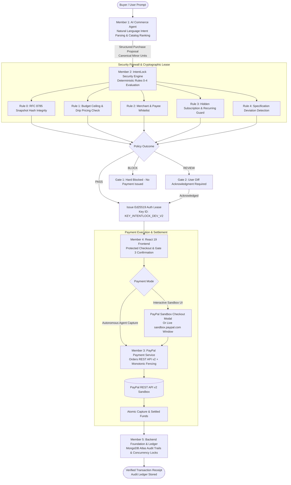

# IntentLock Commerce

<div align="center">

**An AI Personal Shopping Agent with an Intelligent Payment Security Firewall**

*Search intelligently. Verify independently. Pay securely.*

[](https://intentlock-commerce.vercel.app)
[](https://vitest.dev)
[](https://developer.paypal.com)
[](https://datatracker.ietf.org/doc/html/rfc8032)
[](https://nodejs.org)
[](https://react.dev)

</div>

---

## 1. Executive Summary & Vision

Autonomous AI agents are transforming digital commerce by shifting the consumer experience from manual browsing to natural-language delegation. However, autonomous purchasing creates severe financial vulnerabilities: prompt injections, price slippage, hidden recurring fees, merchant spoofing, and rogue checkout modifications.

**IntentLock Commerce** introduces a dual-engine architecture:
1. **AI Commerce Agent:** Discovers products, analyzes specifications, balances tradeoffs, and formulates structured purchase proposals based on natural language user prompts.
2. **Independent Security Engine (IntentLock Firewall):** An isolated, deterministic verification firewall that evaluates the proposed transaction against original user intents and security policies before any payment can be authorized.

> **The Golden Principle:**  
> *AI can discover, recommend, and prepare purchases, but it can never authorize or execute a payment.*  
> Payments are strictly executed via PayPal Sandbox only after deterministic validation, cryptographic authorization (RFC 8032 Ed25519), and explicit, non-bypassable user confirmation.

---

## 2. System Architecture & End-to-End Pipeline



---

## 3. Five-Member Team Architecture

The project is built on a modular, collaborative 5-member microservice architecture:

| Member | Domain & Ownership | Tech Stack | Key Responsibilities |
|:---|:---|:---|:---|
| **Member 1** | **AI Commerce Agent** | Node.js, Express, Claude Tool-Calling | Extracts shopping intents, parses natural language constraints, manages user carts, filters out-of-stock items, and prepares structured `purchase_intent` proposals. |
| **Member 2** | **IntentLock Security Engine** | Python 3.11, Flask, Pure Ed25519, SQLite | Evaluates 5 security dimensions, detects prompt injection & hidden fees, computes canonical hashes (RFC 8785), and signs Ed25519 authorization tokens. |
| **Member 3** | **Payment Orchestration & PayPal** | Node.js, PayPal REST API v2, Webhooks | Verifies Ed25519 tokens, checks single-use nonces, manages idempotency keys, dispatches orders to PayPal Sandbox, and executes atomic captures under monotonic fencing. |
| **Member 4** | **Frontend UI & User Experience** | React 19, Vite, Tailwind CSS 4, Lucide | Responsive shopping interface, natural language assistant, product compare matrix, security drawer, interactive PayPal sandbox checkout modal, and transaction ledger. |
| **Member 5** | **Backend Integration & Architecture Lead** | Node.js, Express, MongoDB / Mongoose | Overall architecture orchestration, strict route guards, CSRF bootstrapping, Argon2id authentication, 14 Mongoose models, and live Vercel production deployment. |

---

## 4. Threat Vector Defense Matrix

IntentLock Commerce deterministically mitigates the seven primary failure modes of autonomous commerce agents:

| # | Threat Vector | Real-World Attack Scenario | IntentLock Defense |
|:---:|:---|:---|:---|
| **1** | **Spec Deviation** | AI quietly selects a cheaper, mismatched variant (e.g. clicky vs tactile switches) to fit the budget. | Non-critical spec mismatches trigger **`REVIEW`**, requiring explicit buyer diff acknowledgment before unlocking payment. |
| **2** | **Price Escalation** | AI proceeds when base price matches, but shipping/handling drives total over the authorized budget. | Total cost evaluation enforces a hard budget ceiling; any overrun results in a deterministic **`BLOCK`**. |
| **3** | **Merchant Spoofing** | Compromised agent redirects checkout to an unverified third-party marketplace seller. | Payee verification against user-approved directories and verified PayPal merchant IDs; mismatches trigger **`BLOCK`**. |
| **4** | **Hidden Subscriptions** | One-time purchase offer secretly enrolls user in a recurring monthly subscription charge. | Structural checkout analysis detects recurring billing schedules and non-zero cycles; triggers immediate **`BLOCK`**. |
| **5** | **Prompt Injection** | Product description text contains hidden prompt instructing agent to approve immediate purchase. | External product content treated as untrusted data; LLM output has zero authorization authority. |
| **6** | **Replay & Duplicate Pay** | Network retry or compromised payload causes duplicate payment authorization execution. | Single-use nonces managed via an atomic two-phase recovery state machine with strict idempotency keys. |
| **7** | **Cart Substitution** | Item SKU, taxes, or shipping mutate after user approval but before payment capture. | Cryptographic binding via Ed25519 signature over an RFC 8785 canonical hash voids payment upon any alteration. |

---

## 5. Live Production Deployment & Demo Walkthrough

### 🌐 Live Application URL
**[https://intentlock-commerce.vercel.app](https://intentlock-commerce.vercel.app)**

### 🚀 1-Minute Live Demo Tour

1. **Strict Route Protection & Authentication:**
   - Visit the root URL `https://intentlock-commerce.vercel.app/`.
   - Unauthenticated visitors are automatically redirected to `/login`.
   - Click **⚡ Enter as Demo Buyer (1-Click Instant Access)** to enter with pre-configured buyer credentials (`demo.buyer@intentlock.io`), or register a new account on `/register`.
2. **AI Shopping Assistant ([`/shopping`](https://intentlock-commerce.vercel.app/shopping)):**
   - Natural language search bar with dynamic parsing (e.g., *"Wireless mechanical keyboard under $120"*).
   - Dynamic budget comparison: product badges dynamically evaluate prices against the active ceiling (`Within Budget` in green vs `Exceeds Budget` in amber).
   - Click **"Select & Configure"** to transition the selected proposal to the Security Gateway.
3. **Product Comparison ([`/compare`](https://intentlock-commerce.vercel.app/compare)):**
   - Multi-column side-by-side spec comparison (Soundcore vs Sony vs JBL) in standard USD pricing.
4. **Deterministic Security Firewall ([`/checkout`](https://intentlock-commerce.vercel.app/checkout)):**
   - Interactive policy outcome simulator:
     - `🟢 PASS (Happy Path)`: Grants RFC 8032 Ed25519 authorization lease (`KEY_INTENTLOCK_DEV_V2`).
     - `🟡 REVIEW (Spec Diff)`: Intercepts tactile vs linear switch difference; prompts buyer diff acknowledgment.
     - `🔴 BLOCK (Over Budget)`: Evaluates against $50 limit; deterministically blocks transaction.
     - `🔴 BLOCK (Payee Mismatch)`: Detects rogue merchant ID; halts Gate 3 permanently.
5. **PayPal Sandbox Payment (Gate 3):**
   - Check the authorization confirmation checkbox and click **Authorize & Create PayPal Order**.
   - **Interactive Mode:** Click the yellow **Open PayPal Sandbox Payment Interface** button to open the authentic PayPal Sandbox checkout modal (`buyer@sandbox.paypal.com` with a simulated balance of `$1,000.00 USD`). Click **Pay Now** to approve.
   - **Autonomous Mode:** Click **Complete & Capture Order** for instant 1-click autonomous agent settlement.
6. **Transaction History & Audit Trail ([`/transactions`](https://intentlock-commerce.vercel.app/transactions)):**
   - Real-time ledger updates: newly captured orders immediately prepend to the top of the transaction history with their capture ID (`CAP_...`), timestamp, status (`COMPLETED`), and security stamp (`Verified (Ed25519 Signed)`).

---

## 6. Technology Stack

### Frontend Client
- **Framework:** React 19, Vite 8.3
- **Styling:** Tailwind CSS 4.3 (Teal + Warm White FinTech design system)
- **Icons & UI:** Lucide React, Canvas Confetti
- **State & Routing:** React Router v7, Context API (`AuthContext`, `ToastContext`)
- **Hosting:** Vercel Edge Network (Global CDN with SPA rewrites)

### Backend Services & Security
- **Runtime:** Node.js (v20+) & Python (v3.11+)
- **API Frameworks:** Express.js 4 (Node), Flask (Python)
- **Database & ODM:** MongoDB Atlas, Mongoose 8.8 (14 models, BSON Long minor units, compound unique indexes)
- **Cryptography:** Ed25519 (RFC 8032), RFC 8785 Canonical JSON (JCS), SHA-256 / SHA-512
- **Password Security:** Argon2id hashing
- **Security Middleware:** Helmet CSP headers, CSRF token validation, express-rate-limit

### Payment Gateway
- **Provider:** PayPal REST API v2
- **Environment:** PayPal Sandbox (`https://api-m.sandbox.paypal.com`)
- **Fencing:** Monotonic fencing tokens, stable idempotency keys, single-use nonces

---

## 7. Local Development Quickstart

### Prerequisites
- Node.js >= 20.0.0
- npm >= 10.0.0
- MongoDB (local Community Server or MongoDB Atlas URI)
- Python >= 3.11 (optional for running Python security engine locally)

### Installation

```bash
# 1. Clone repository
git clone https://github.com/adityasing9/PayPal.git
cd PayPal

# 2. Install Node.js dependencies
npm install

# 3. Configure environment
cp .env.example .env
# Edit .env with your MongoDB URI and PayPal Sandbox credentials if available
```

### Running the Application

```bash
# Run backend server (Port 3000 / 5001)
npm start

# Run frontend development server (Port 5173 / Vite)
npm run dev:frontend

# Run Member 1 AI Commerce Agent API (Port 8000)
npm run start:agent
```

---

## 8. Verification & Test Suite

The project includes an exhaustive testing suite covering unit, integration, crypto-interoperability, and red-team attack scenarios:

```bash
# Run Vitest test suite (347 tests across 28 files)
npm test

# Run Member 1 verification suite (18 unit tests + 17-point audit)
npm run check

# Run linter
npm run lint

# Build production bundle
npm run build
```

### Test Coverage Highlights
- `tests/unit/cryptoUtils.test.js`: RFC 8032 Ed25519 keypair verification, signature generation, and tamper detection.
- `tests/unit/canonicalJson.test.js`: RFC 8785 JCS deterministic sorting and UTF-16 character handling.
- `tests/unit/securityFirewall.test.js`: Deterministic rules 0 through 4 (PASS, REVIEW, BLOCK matrix).
- `tests/unit/paypalIntegration.test.js`: PayPal Orders REST API v2, atomic capture, and webhook verification.
- `tests/unit/intentLockV2Verifier.test.js`: Python Flask-to-Node cross-language cryptographic token interoperability.
- `tests/integration/e2eFlow.test.js`: Full multi-member end-to-end purchase lifecycle (Prompt ➔ Intent ➔ Firewall ➔ PayPal Order ➔ Capture).

---

## 9. API Reference Summary

### Authentication & Session (`/api/auth`)
| Method | Endpoint | Description |
|:---|:---|:---|
| `GET` | `/api/auth/csrf` | Bootstraps or refreshes the CSRF token (`X-CSRF-Token`). |
| `POST` | `/api/auth/register` | Registers a new buyer account; hashes password with Argon2id. |
| `POST` | `/api/auth/login` | Authenticates buyer credentials; sets HttpOnly session cookie. |
| `GET` | `/api/auth/me` | Retrieves the currently authenticated buyer profile. |
| `POST` | `/api/auth/logout` | Terminates active session; clears session cookie and storage. |

### Shopping & Security (`/api`)
| Method | Endpoint | Description |
|:---|:---|:---|
| `POST` | `/api/intents` | Creates an intent constraint record with max budget ceiling. |
| `GET` | `/api/products` | Queries verified merchant catalog with category and price filters. |
| `POST` | `/api/security/verify` | Executes 5-dimension deterministic firewall scan; issues Ed25519 lease. |

### Payments & PayPal Gateway (`/api/payments`)
| Method | Endpoint | Description |
|:---|:---|:---|
| `POST` | `/api/payments/create-order` | Dispatches validated proposal to PayPal Sandbox REST API v2. |
| `POST` | `/api/payments/capture-order` | Executes atomic financial capture under monotonic fencing token. |
| `POST` | `/api/payments/recover-session` | Recovers in-flight PayPal orders safely across cross-origin redirects. |
| `POST` | `/api/webhooks/paypal` | Ingests and verifies PayPal webhooks with signature verification. |

---

## 10. Repository Structure

```
PayPal/
├── src/                          # Node.js Fullstack & Backend Source
│   ├── config/                   # Database (Mongoose), env validation, keys
│   ├── controllers/              # Auth, intents, proposals, payments, security
│   ├── middleware/               # Rate limiters, CSRF, Helmet, error handlers
│   ├── models/                   # 14 Mongoose Data Models (User, Transaction, etc.)
│   ├── repositories/             # Authorization, JobLock, PaymentTransaction repos
│   ├── routes/                   # Modular Express routers (/auth, /payments, etc.)
│   ├── services/                 # AuthService, PayPalService, SecurityFirewallService
│   ├── utils/                    # RFC 8032 Ed25519, RFC 8785 canonical JSON
│   ├── pages/                    # React 19 Pages (Dashboard, Shopping, Checkout, etc.)
│   ├── components/               # Navbar, layout shells, interactive UI widgets
│   ├── context/                  # AuthContext, ToastContext
│   ├── app.js                    # Express app factory with Helmet & CORS
│   └── server.js                 # HTTP server bootstrapper with DB connection
├── intentlock/                   # Python Security Engine (Member 2)
│   ├── core/                     # Config, models, errors
│   ├── workstream1_verification/ # Price & merchant verifiers
│   ├── workstream2_hidden_costs/ # Drip pricing & subscription detector
│   ├── workstream3_threat_intel/ # Prompt injection & threat scoring
│   ├── workstream4_crypto_auth/  # RFC 8785 JCS, Ed25519 signer, nonce guard
│   └── workstream5_api_db/       # Flask REST API, audit repo, inter-team contracts
├── tests/                        # Comprehensive Testing Infrastructure
│   ├── unit/                     # Unit suites (crypto, schemas, models, PayPal)
│   ├── integration/              # Multi-member orchestration & concurrency tests
│   └── helpers/                  # Test clients, Flask service runners, mock data
├── contracts/                    # Team handoff specifications & test vectors
├── docs/                         # Architecture, API contracts, deployment guides
├── public/                       # Static assets & icons
├── vercel.json                   # Vercel production routing & configuration
└── package.json                  # Dependencies, scripts, and build configuration
```

---

## 11. License

This project is licensed under the MIT License — see the LICENSE file for details.
Developed for the **PayPal AI Hackathon 2026**.
