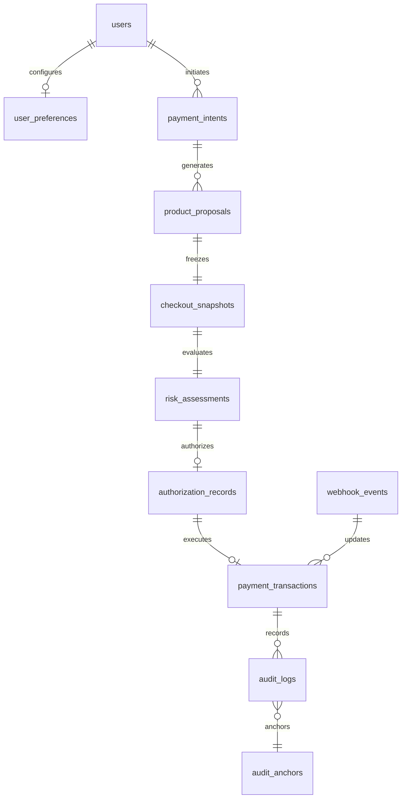

# IntentLock Commerce — Database Design & Schema Architecture

> **Document Status:** CONFIRMED BASELINE & SCHEMA SPECIFICATION (v1.2)  
> **Last Updated:** 2026-11-07  
> **Lead Architect:** Aditya Singh (`adityasing9`) — Member 5  
> **Database Engine:** MongoDB 7.0+ (Mongoose ODM)  

---

## 1. Core Principles, 64-Bit Financial Representation & Precision

1. **64-Bit Integer Minor Unit Representation:**
   To completely prevent floating-point inaccuracies (`0.1 + 0.2 !== 0.3`), all monetary amounts are stored as **BSON Long (64-bit integer minor units)**. In Node.js, these values are handled using native `BigInt` or safe integers up to `Number.MAX_SAFE_INTEGER` ($9,007,199,254,740,991$).
2. **Currency Precision & Exponent Modeling:**
   Every monetary figure is bound to an ISO-4217 currency code and an explicit `minorUnitExponent`:
   - **Exponent 2 (Standard):** USD, EUR, GBP, CAD (\$1.00 = `100` minor units).
   - **Exponent 0 (Zero-Decimal):** JPY, KRW (¥100 = `100` minor units).
   - **Exponent 3 (Three-Decimal):** BHD, KWD, OMR (1 KWD = `1000` minor units).
3. **Crash-Safe Nonce State Transitions & In-Flight Recovery:**
   `authorization_records` support two-phase locking (`PENDING` $\longrightarrow$ `IN_FLIGHT` $\longrightarrow$ `CONSUMED`) linked to an `idempotencyKey`. A 5-minute expiry prevents new payment dispatch, but an in-flight transaction is recoverable via its original idempotency key without ever creating a second payment.
4. **Offline Catalog Fixture Baseline:**
   To support offline development, `products` is seeded with **15–20 realistic e-commerce products** across three target categories:
   - Keyboards (Mechanical, Wireless, Ergonomic, RGB/White backlight)
   - Headphones (Active Noise Cancelling, Wireless, Studio Monitor)
   - Monitors (4K USB-C, High Refresh Gaming, Ultrawide)
5. **Dual-Trigger Audit Anchoring:**
   Root chain hashes are published externally every **60 minutes** and immediately upon transactions exceeding a configurable high-value threshold (`HIGH_VALUE_ANCHOR_THRESHOLD_MINOR`, default: `20000` = \$200.00).

---

## 2. Collection Relationship Diagram



---

## 3. Detailed Collection Schemas

### 3.1 `users`
```javascript
const UserSchema = new Schema({
  email: { type: String, required: true, unique: true, lowercase: true, trim: true },
  passwordHash: { type: String, required: true },
  name: { type: String, required: true, trim: true },
  role: { type: String, enum: ['USER', 'ADMIN'], default: 'USER' },
  isActive: { type: Boolean, default: true }
}, { timestamps: true });

UserSchema.index({ email: 1 }, { unique: true });
```

### 3.2 `user_preferences`
```javascript
const UserPreferenceSchema = new Schema({
  userId: { type: Schema.Types.ObjectId, ref: 'users', required: true, unique: true },
  defaultCurrency: { type: String, default: 'USD', uppercase: true, minlength: 3, maxlength: 3 },
  minorUnitExponent: { type: Number, default: 2, required: true },
  maxTransactionLimitMinor: { type: Schema.Types.Long, required: true, min: 0 },
  dailySpendingLimitMinor: { type: Schema.Types.Long, required: true, min: 0 },
  allowedMerchants: [{ type: String, trim: true }],
  blockedMerchants: [{ type: String, trim: true }],
  requireExplicitReviewOverMinor: { type: Schema.Types.Long, default: 20000 }
}, { timestamps: true });

UserPreferenceSchema.index({ userId: 1 }, { unique: true });
```

### 3.3 `payment_intents`
```javascript
const PaymentIntentSchema = new Schema({
  userId: { type: Schema.Types.ObjectId, ref: 'users', required: true, index: true },
  version: { type: Number, default: 1, required: true },
  prompt: { type: String, required: true, trim: true },
  maxBudgetMinor: { type: Schema.Types.Long, required: true, min: 1 },
  currency: { type: String, required: true, uppercase: true, minlength: 3, maxlength: 3 },
  minorUnitExponent: { type: Number, default: 2, required: true },
  category: { type: String, enum: ['Keyboards', 'Headphones', 'Monitors', 'General'], default: 'General' },
  requiredSpecs: { type: Map, of: String, default: {} },
  status: {
    type: String,
    enum: ['INITIALIZED', 'SEARCHING', 'PROPOSED', 'APPROVED', 'CANCELLED', 'EXPIRED'],
    default: 'INITIALIZED'
  },
  previousVersionId: { type: Schema.Types.ObjectId, ref: 'payment_intents', default: null }
}, { timestamps: true });

PaymentIntentSchema.index({ userId: 1, createdAt: -1 });
PaymentIntentSchema.index({ userId: 1, version: 1 });
```

### 3.4 `products`
```javascript
const ProductSchema = new Schema({
  externalId: { type: String, required: true, unique: true, index: true },
  title: { type: String, required: true, trim: true },
  description: { type: String, trim: true }, // Treated as untrusted passive data
  category: { type: String, enum: ['Keyboards', 'Headphones', 'Monitors'], required: true },
  merchantId: { type: String, required: true, index: true },
  merchantName: { type: String, required: true },
  basePriceMinor: { type: Schema.Types.Long, required: true, min: 0 },
  currency: { type: String, required: true, uppercase: true },
  minorUnitExponent: { type: Number, default: 2, required: true },
  specifications: { type: Map, of: Schema.Types.Mixed },
  specHash: { type: String, required: true },
  productUrl: { type: String, required: true },
  catalogSource: {
    type: String,
    enum: ['CHANNEL3_OFFLINE_FIXTURE', 'CHANNEL3_API', 'MOCK'],
    default: 'CHANNEL3_OFFLINE_FIXTURE'
  },
  isVerified: { type: Boolean, default: false }
}, { timestamps: true });

ProductSchema.index({ externalId: 1 }, { unique: true });
ProductSchema.index({ merchantId: 1 });
ProductSchema.index({ category: 1 });
```

### 3.5 `product_proposals`
```javascript
const ProductProposalSchema = new Schema({
  intentId: { type: Schema.Types.ObjectId, ref: 'payment_intents', required: true, index: true },
  productId: { type: Schema.Types.ObjectId, ref: 'products', required: true },
  variantSku: { type: String, required: true },
  title: { type: String, required: true },
  merchantId: { type: String, required: true },
  paypalMerchantId: { type: String, required: true },
  pricing: {
    basePriceMinor: { type: Schema.Types.Long, required: true },
    shippingMinor: { type: Schema.Types.Long, default: 0 },
    taxMinor: { type: Schema.Types.Long, default: 0 },
    discountMinor: { type: Schema.Types.Long, default: 0 },
    totalPriceMinor: { type: Schema.Types.Long, required: true },
    currency: { type: String, required: true },
    minorUnitExponent: { type: Number, default: 2, required: true }
  },
  recurring: {
    isRecurring: { type: Boolean, default: false, required: true },
    billingInterval: { type: String, default: null },
    billingCycles: { type: Number, default: 0 }
  },
  recommendationRank: { type: Number, default: 1 },
  agentRationale: { type: String, trim: true },
  status: {
    type: String,
    enum: ['PENDING_VERIFICATION', 'VERIFIED_PASS', 'VERIFIED_REVIEW', 'BLOCKED', 'SELECTED', 'REJECTED'],
    default: 'PENDING_VERIFICATION'
  }
}, { timestamps: true });

ProductProposalSchema.index({ intentId: 1, createdAt: -1 });
```

### 3.6 `checkout_snapshots`
```javascript
const CheckoutSnapshotSchema = new Schema({
  proposalId: { type: Schema.Types.ObjectId, ref: 'product_proposals', required: true, unique: true },
  intentId: { type: Schema.Types.ObjectId, ref: 'payment_intents', required: true },
  snapshotPayload: {
    productId: { type: String, required: true },
    variantSku: { type: String, required: true },
    merchantId: { type: String, required: true },
    paypalMerchantId: { type: String, required: true },
    lineItems: [
      {
        sku: { type: String, required: true },
        name: { type: String, required: true },
        quantity: { type: Number, required: true, min: 1 },
        unitPriceMinor: { type: Schema.Types.Long, required: true }
      }
    ],
    pricing: {
      basePriceMinor: { type: Schema.Types.Long, required: true },
      shippingMinor: { type: Schema.Types.Long, required: true },
      taxMinor: { type: Schema.Types.Long, required: true },
      discountMinor: { type: Schema.Types.Long, required: true },
      totalPriceMinor: { type: Schema.Types.Long, required: true },
      currency: { type: String, required: true },
      minorUnitExponent: { type: Number, required: true }
    },
    recurring: {
      isRecurring: { type: Boolean, required: true },
      billingInterval: { type: String, default: null },
      billingCycles: { type: Number, default: 0 }
    },
    specifications: { type: Map, of: Schema.Types.Mixed, required: true }
  },
  snapshotHash: { type: String, required: true },
  capturedAt: { type: Date, default: Date.now, required: true }
}, { timestamps: false });

CheckoutSnapshotSchema.index({ proposalId: 1 }, { unique: true });
```

### 3.7 `risk_assessments`
```javascript
const RiskAssessmentSchema = new Schema({
  proposalId: { type: Schema.Types.ObjectId, ref: 'product_proposals', required: true, index: true },
  snapshotHash: { type: String, required: true },
  decision: { type: String, enum: ['PASS', 'REVIEW', 'BLOCK'], required: true },
  riskScore: { type: Number, required: true, min: 0, max: 1 },
  failedRuleCodes: [{ type: String }],
  specDifferences: [
    {
      attribute: { type: String, required: true },
      requested: { type: String, required: true },
      proposed: { type: String, required: true },
      criticality: { type: String, enum: ['CRITICAL', 'NON_CRITICAL'], default: 'NON_CRITICAL' }
    }
  ],
  ruleEvaluationResults: { type: Schema.Types.Mixed, required: true },
  evaluatedAt: { type: Date, default: Date.now, required: true }
}, { timestamps: true });

RiskAssessmentSchema.index({ proposalId: 1 });
RiskAssessmentSchema.index({ decision: 1 });
```

### 3.8 `authorization_records`
```javascript
const AuthorizationRecordSchema = new Schema({
  proposalId: { type: Schema.Types.ObjectId, ref: 'product_proposals', required: true },
  intentId: { type: Schema.Types.ObjectId, ref: 'payment_intents', required: true },
  snapshotHash: { type: String, required: true },
  algorithm: { type: String, default: 'Ed25519', required: true },
  publicKey: { type: String, required: true },
  nonce: { type: String, required: true, unique: true },
  canonicalJsonHash: { type: String, required: true },
  authorizedAmountMinor: { type: Schema.Types.Long, required: true },
  currency: { type: String, required: true },
  minorUnitExponent: { type: Number, default: 2, required: true },
  signature: { type: String, required: true },
  status: {
    type: String,
    enum: ['PENDING', 'IN_FLIGHT', 'CONSUMED', 'EXPIRED', 'REVOKED', 'FAILED'],
    default: 'PENDING'
  },
  idempotencyKey: { type: String, default: null, index: true },
  inFlightStartedAt: { type: Date, default: null },
  expiresAt: { type: Date, required: true, index: true },
  consumedAt: { type: Date, default: null }
}, { timestamps: true });

AuthorizationRecordSchema.index({ nonce: 1 }, { unique: true });
AuthorizationRecordSchema.index({ expiresAt: 1 }, { expireAfterSeconds: 0 });
```

### 3.9 `payment_transactions`
```javascript
const PaymentTransactionSchema = new Schema({
  userId: { type: Schema.Types.ObjectId, ref: 'users', required: true, index: true },
  authorizationId: { type: Schema.Types.ObjectId, ref: 'authorization_records', required: true, unique: true },
  proposalId: { type: Schema.Types.ObjectId, ref: 'product_proposals', required: true },
  paypalOrderId: { type: String, required: true, unique: true },
  paypalCaptureId: { type: String, default: null, index: true },
  idempotencyKey: { type: String, required: true, unique: true },
  amountMinor: { type: Schema.Types.Long, required: true },
  currency: { type: String, required: true },
  minorUnitExponent: { type: Number, default: 2, required: true },
  status: {
    type: String,
    enum: ['CREATED', 'APPROVED_BY_USER', 'CAPTURING', 'COMPLETED', 'FAILED', 'REFUNDED'],
    default: 'CREATED'
  },
  payerEmail: { type: String },
  sellerProtectionStatus: { type: String },
  failureReason: { type: String }
}, { timestamps: true });

PaymentTransactionSchema.index({ paypalOrderId: 1 }, { unique: true });
PaymentTransactionSchema.index({ idempotencyKey: 1 }, { unique: true });
```

### 3.10 `webhook_events`
```javascript
const WebhookEventSchema = new Schema({
  paypalEventId: { type: String, required: true, unique: true },
  eventType: { type: String, required: true },
  resourceType: { type: String, required: true },
  summary: { type: String },
  payload: { type: Schema.Types.Mixed, required: true },
  signatureVerified: { type: Boolean, required: true },
  processedStatus: { type: String, enum: ['PROCESSED', 'IGNORED', 'FAILED'], default: 'PROCESSED' }
}, { timestamps: true });

WebhookEventSchema.index({ paypalEventId: 1 }, { unique: true });
```

### 3.11 `audit_logs`
```javascript
const AuditLogSchema = new Schema({
  eventType: {
    type: String,
    enum: [
      'INTENT_CREATED', 'PROPOSAL_GENERATED', 'SECURITY_EVALUATION',
      'AUTHORIZATION_ISSUED', 'NONCE_LOCKED_IN_FLIGHT', 'NONCE_CONSUMED',
      'PAYMENT_ORDER_CREATED', 'PAYMENT_CAPTURED', 'REPLAY_ATTACK_BLOCKED',
      'REVIEW_ACKNOWLEDGED', 'WEBHOOK_PROCESSED', 'AUDIT_ANCHOR_PUBLISHED',
      'RATE_LIMIT_EXCEEDED'
    ],
    required: true
  },
  userId: { type: Schema.Types.ObjectId, ref: 'users' },
  referenceId: { type: String, required: true },
  details: { type: Schema.Types.Mixed, required: true },
  actor: { type: String, required: true },
  ipAddress: { type: String },
  previousLogHash: { type: String, default: null },
  logHash: { type: String, required: true }
}, { timestamps: { createdAt: true, updatedAt: false } });

AuditLogSchema.index({ eventType: 1, createdAt: -1 });
AuditLogSchema.index({ referenceId: 1 });
```

### 3.12 `audit_anchors`
```javascript
const AuditAnchorSchema = new Schema({
  anchorTipLogId: { type: Schema.Types.ObjectId, ref: 'audit_logs', required: true },
  anchorHash: { type: String, required: true },
  triggerType: {
    type: String,
    enum: ['SCHEDULED_60_MIN', 'HIGH_VALUE_TRANSACTION'],
    required: true
  },
  transactionAmountMinor: { type: Schema.Types.Long, default: null },
  externalTarget: { type: String, enum: ['WORM_STORAGE', 'RFC3161_TSA', 'PUBLIC_LEDGER'], required: true },
  externalReceiptId: { type: String, required: true },
  anchoredAt: { type: Date, default: Date.now, required: true }
}, { timestamps: false });

AuditAnchorSchema.index({ anchoredAt: -1 });
AuditAnchorSchema.index({ triggerType: 1 });
```
