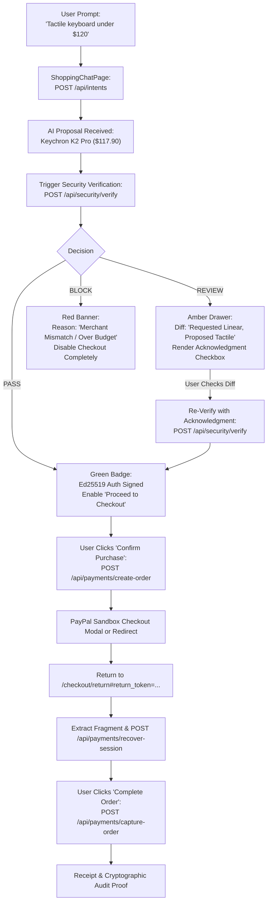

# IntentLock Commerce — Frontend Integration Guide

> **Document Status:** RATIFIED FRONTEND SPECIFICATION (v2.0)  
> **Target Audience:** AuGust (`AuGust`) — Member 4 (Frontend UI/UX Lead)  
> **Author & Integrator:** Aditya Singh (`adityasing9`) — Member 5 (Backend Lead)  
> **Last Updated:** 2026-11-08  
> **Backend Host:** `http://localhost:5000/api` (Configurable via `VITE_API_URL` or proxy)  
> **Frontend Host:** `http://localhost:3000`  
> **Inviolable Principle:** *The frontend must never independently decide that a payment is safe. The backend security engine is authoritative.*

---

## 1. Frontend Architecture & Technology Stack

### Recommended Stack
- **Framework:** React 18+ (Vite recommended for fast HMR and optimized builds)
- **Styling:** Tailwind CSS (with `@tailwindcss/forms` for accessible inputs)
- **Icons:** Lucide React (`lucide-react`)
- **State Management:** React Context + hooks (or Zustand)
- **HTTP Client:** Native `fetch` with a unified API wrapper or `axios` configured with `withCredentials: true`
- **Routing:** React Router DOM (v6+)

### Project Structure (Recommended under `frontend/` or `client/`)
```text
frontend/
├── src/
│   ├── api/
│   │   ├── client.js          # Unified fetch client with CSRF & credential injection
│   │   ├── auth.js            # Login, register, logout, me, csrf
│   │   ├── intents.js         # Create intent, fetch intent
│   │   ├── proposals.js       # Fetch proposal details
│   │   ├── security.js        # Verify proposal (PASS/REVIEW/BLOCK)
│   │   └── payments.js        # Create order, recover session, capture order
│   ├── components/
│   │   ├── Navbar.jsx         # User status, logout button
│   │   ├── IntentInput.jsx    # Natural-language shopping prompt bar & budget slider
│   │   ├── ProductCard.jsx    # Candidate product card
│   │   ├── ComparisonTable.jsx# Side-by-side spec comparison
│   │   ├── FirewallDrawer.jsx # Security Inspection Drawer (PASS / REVIEW / BLOCK)
│   │   ├── ReviewDiffModal.jsx# Specification difference acknowledgment modal
│   │   └── PayPalButton.jsx   # PayPal Smart Button wrapper
│   ├── contexts/
│   │   └── AuthContext.jsx    # User session, CSRF token, login/logout handlers
│   ├── pages/
│   │   ├── LoginPage.jsx
│   │   ├── RegisterPage.jsx
│   │   ├── ShoppingChatPage.jsx# Main conversational shopping experience
│   │   ├── ReturnPage.jsx     # Return redirect trampoline & recovery view (/checkout/return)
│   │   └── ReceiptPage.jsx    # Post-capture confirmation and audit proof
│   └── App.jsx
```

---

## 2. API Client & Security Transport Requirements

### 2.1 Credential Transport & `SameSite=Strict` Cookies
- The backend sets an `HttpOnly`, `Secure`, `SameSite=Strict` cookie named `intentlock_session`.
- **Browser JavaScript CANNOT read this cookie.**
- Every API request must include credentials:
  - In `fetch`: `{ credentials: 'include' }`
  - In `axios`: `axios.defaults.withCredentials = true`
- Check active session state on application load by calling `GET /api/auth/me`.

### 2.2 CSRF Token Lifecycle
All state-mutating requests (`POST`, `PUT`, `DELETE`, `PATCH`) require the `X-CSRF-Token` header.
1. **Bootstrap:** On App initialization, fetch the initial CSRF token via `GET /api/auth/csrf`.
2. **Store in Memory:** Store `csrfToken` in React state or AuthContext (never in `localStorage`).
3. **Attach Header:** Automatically inject `headers['X-CSRF-Token'] = csrfToken` on all non-GET requests.
4. **Refresh on Auth Changes:** Re-fetch the CSRF token upon successful login or registration, because the token binds to the authenticated user ID and session version.

### 2.3 Idempotency Key Generation
- Endpoints `POST /api/payments/create-order` and `POST /api/payments/capture-order` require a unique UUIDv4 header:
  `Idempotency-Key: crypto.randomUUID()`
- If a network error occurs, retry the request with the **exact same** `Idempotency-Key`. The backend returns the cached transaction without creating a duplicate payment.

### 2.4 Reference API Client Implementation
```javascript
// src/api/client.js
let cachedCsrfToken = null;

export async function initCsrfToken() {
  const res = await fetch('http://localhost:5000/api/auth/csrf', {
    credentials: 'include'
  });
  const json = await res.json();
  if (json.success) {
    cachedCsrfToken = json.data.csrfToken;
  }
  return cachedCsrfToken;
}

export function setCsrfToken(token) {
  cachedCsrfToken = token;
}

export async function apiRequest(path, options = {}) {
  const url = `http://localhost:5000/api${path}`;
  const headers = {
    'Content-Type': 'application/json',
    ...(options.headers || {})
  };

  const method = (options.method || 'GET').toUpperCase();
  if (!['GET', 'HEAD', 'OPTIONS'].includes(method)) {
    if (!cachedCsrfToken) {
      await initCsrfToken();
    }
    headers['X-CSRF-Token'] = cachedCsrfToken;
  }

  const response = await fetch(url, {
    ...options,
    headers,
    credentials: 'include'
  });

  const body = await response.json().catch(() => ({}));

  if (!response.ok) {
    const error = new Error(body.error?.message || 'API request failed');
    error.code = body.error?.code || 'UNKNOWN_ERROR';
    error.status = response.status;
    error.details = body.error?.details || [];
    throw error;
  }

  return body.data;
}
```

---

## 3. UI Component Responsibilities & User Experience



### 3.1 Security Decision Visualizer: The IntentLock Firewall Drawer
The centerpiece of the user experience is the **IntentLock Security Inspection Drawer**. It displays transparent, verifiable evidence for the AI's proposed purchase.

| Security Outcome | Visual State | Action Enabled | Required User Interaction |
| :--- | :--- | :--- | :--- |
| **`PASS`** | 🟢 Green badge, shield icon, risk score (e.g. `0.02`), budget delta, payee whitelist confirmed. | **"Proceed to Checkout"** button active. | Single confirmation click. |
| **`REVIEW`** | 🟡 Amber/Yellow banner, warning icon, specification diff panel. | **"Acknowledge & Re-Evaluate"** button active. | User must explicitly check the acknowledged diff boxes before checkout can proceed. |
| **`BLOCK`** | 🔴 Red banner, hazard icon, concrete failure code and explanation. | **Checkout strictly disabled.** | Inform user that this product violates hard financial/merchant policies. |

#### Rendering REVIEW Specification Diffs
When `decision === 'REVIEW'`:
1. Extract `data.specDifferences` (e.g., `[{ attribute: 'switchType', requested: 'Linear', proposed: 'Tactile' }]`).
2. Render a side-by-side comparison table.
3. Provide an explicit checkbox:
   `[x] I understand and accept that the proposed switch type (Tactile) differs from my original prompt (Linear).`
4. When checked, re-invoke `POST /api/security/verify` passing:
   `acknowledgedReviewDiffs: ['switchType']`.
5. Upon successful re-evaluation, the backend returns `PASS` along with the signed Ed25519 authorization packet.

#### Rendering BLOCK Policy Violations
When `decision === 'BLOCK'`:
- Display the specific error code:
  - `BUDGET_EXCEEDED`: *"Total cost exceeds your specified budget ceiling."*
  - `CRITICAL_VIOLATION_MERCHANT_MISMATCH`: *"Payee is not in your verified merchant directory."*
  - `UNEXPECTED_RECURRING_CHARGE`: *"Hidden recurring subscription detected."*
  - `SNAPSHOT_TAMPERING_DETECTED`: *"Product price or parameters were modified."*
- **Never allow the user to override a `BLOCK`.**

---

## 4. PayPal Checkout & Return Handling

### 4.1 Dispatching Order (`POST /api/payments/create-order`)
When the user clicks **"Proceed to Checkout"**:
```javascript
import { apiRequest } from '../api/client';

async function handleCreateOrder({ proposalId, authorizationId, acknowledgedDiffs }) {
  const order = await apiRequest('/payments/create-order', {
    method: 'POST',
    headers: {
      'Idempotency-Key': crypto.randomUUID()
    },
    body: JSON.stringify({
      proposalId,
      authorizationId,
      userConsent: true, // Non-negotiable: must be literal true
      acknowledgedReviewDiffs: acknowledgedDiffs || []
    })
  });

  // order contains: { orderId, approvalUrl, returnToken }
  return order;
}
```

### 4.2 Handling the Return Navigation (`/checkout/return`)

When PayPal redirects the user back to the application:
`http://localhost:3000/checkout/return?orderId=PAYPAL_ORDER_88392104A1B2#return_token=ret_tok_a1b2c3d4e5f67890`

#### CRITICAL SECURITY IMPLEMENTATION FOR MEMBER 4:
1. **Immediate Fragment Sanitization:**  
   Extract `#return_token=...` from `window.location.hash`, and immediately strip the fragment using:
   ```javascript
   window.history.replaceState(null, '', window.location.pathname + window.location.search);
   ```
   *Why?* Fragments do not transmit over HTTP, but they remain visible in browser history and address bars unless cleared.
2. **Never Log or Store:** Do NOT log `return_token` to console or save it in `localStorage`.
3. **Session Recovery Call:** Immediately call `POST /api/payments/recover-session`.
4. **Display Explicit Confirmation:** Render a review screen showing recovered `amountMinor` and `orderId`.
5. **Final Capture Click:** User clicks **"Confirm & Complete Payment"** to trigger `POST /api/payments/capture-order`.

#### Complete ReturnPage Component Example
```jsx
// src/pages/ReturnPage.jsx
import React, { useEffect, useState } from 'react';
import { useSearchParams, useNavigate } from 'react-router-dom';
import { apiRequest } from '../api/client';

export default function ReturnPage({ authorizationId }) {
  const [searchParams] = useSearchParams();
  const navigate = useNavigate();
  const orderId = searchParams.get('orderId');

  const [recoveredData, setRecoveredData] = useState(null);
  const [error, setError] = useState(null);
  const [capturing, setCapturing] = useState(false);

  useEffect(() => {
    async function recover() {
      try {
        // 1. Extract return token from URL fragment
        const hash = window.location.hash;
        const match = hash.match(/#return_token=([^&]+)/);
        const returnToken = match ? decodeURIComponent(match[1]) : null;

        // 2. Immediately strip fragment from browser address bar
        window.history.replaceState(
          null,
          '',
          window.location.pathname + window.location.search
        );

        if (!returnToken || !orderId) {
          throw new Error('Missing return token or order ID in redirect parameters.');
        }

        // 3. Atomically recover session context
        const data = await apiRequest('/payments/recover-session', {
          method: 'POST',
          body: JSON.stringify({ orderId, returnToken })
        });

        setRecoveredData(data);
      } catch (err) {
        setError(err.message || 'Failed to recover checkout session.');
      }
    }

    recover();
  }, [orderId]);

  async function handleFinalCapture() {
    setCapturing(true);
    setError(null);
    try {
      const receipt = await apiRequest('/payments/capture-order', {
        method: 'POST',
        headers: {
          'Idempotency-Key': crypto.randomUUID()
        },
        body: JSON.stringify({
          orderId,
          authorizationId
        })
      });

      navigate('/checkout/receipt', { state: { receipt } });
    } catch (err) {
      setError(err.message || 'Payment capture failed.');
    } finally {
      setCapturing(false);
    }
  }

  if (error) {
    return (
      <div className="p-8 max-w-md mx-auto text-center">
        <h2 className="text-xl font-bold text-red-600 mb-2">Recovery Failed</h2>
        <p className="text-gray-700 mb-4">{error}</p>
        <button
          onClick={() => navigate('/')}
          className="px-4 py-2 bg-gray-800 text-white rounded"
        >
          Return to Shopping
        </button>
      </div>
    );
  }

  if (!recoveredData) {
    return (
      <div className="p-8 text-center">
        <p className="text-gray-600 animate-pulse">
          Securing and restoring your checkout session...
        </p>
      </div>
    );
  }

  return (
    <div className="p-8 max-w-lg mx-auto bg-white rounded-xl shadow-md border border-gray-100">
      <h2 className="text-2xl font-bold text-gray-900 mb-4">Confirm Your Purchase</h2>
      <div className="bg-gray-50 p-4 rounded-lg mb-6">
        <p className="text-sm text-gray-500">PayPal Order ID</p>
        <p className="font-mono text-gray-800 mb-2">{recoveredData.orderId}</p>
        <p className="text-sm text-gray-500">Authorized Total</p>
        <p className="text-2xl font-bold text-emerald-600">
          ${(Number(recoveredData.amountMinor) / 100).toFixed(2)} {recoveredData.currency}
        </p>
      </div>

      <button
        onClick={handleFinalCapture}
        disabled={capturing}
        className="w-full py-3 bg-emerald-600 hover:bg-emerald-700 text-white font-semibold rounded-lg transition disabled:opacity-50"
      >
        {capturing ? 'Capturing Payment...' : 'Confirm & Complete Payment'}
      </button>
    </div>
  );
}
```

---

## 5. Error Code Directory for UI Toast / Notification Handling

| Backend Error Code | HTTP Status | Recommended User Display Message |
| :--- | :---: | :--- |
| `AUTHENTICATION_REQUIRED` | 401 | *"Your session has expired. Please log in to continue."* |
| `SESSION_REVOKED` | 401 | *"This session was invalidated. Please log in again."* |
| `INVALID_OR_EXPIRED_RETURN_TOKEN` | 401 | *"Checkout session link expired or already used. Please restart checkout."* |
| `CSRF_TOKEN_MISSING` / `CSRF_VALIDATION_FAILED` | 403 | *"Security token mismatch. Refreshing session..."* (Auto re-fetch CSRF) |
| `USER_MISMATCH` | 403 | *"Security violation: This authorization does not belong to your account."* |
| `USER_CONSENT_REQUIRED` | 400 | *"You must explicitly confirm purchase before proceeding."* |
| `PROPOSAL_ID_MISMATCH` | 400 | *"Payment authorization does not match the active proposal."* |
| `INTENT_VERSION_MISMATCH` | 400 | *"Shopping intent was modified concurrently. Re-evaluating proposal."* |
| `AUTHORIZATION_ID_MISMATCH` | 400 | *"Authorization verification failed prior to capture."* |
| `RATE_LIMIT_EXCEEDED` | 429 | *"Too many requests. Please pause for a moment and retry."* |
| `IDEMPOTENCY_KEY_REQUIRED` | 400 | *"Client error: Unique request ID header missing."* |
| `BUDGET_EXCEEDED` | 200 (BLOCK) | *"Total cost exceeds your specified budget."* |
| `CRITICAL_VIOLATION_MERCHANT_MISMATCH` | 200 (BLOCK) | *"Payee does not match the verified merchant directory."* |
| `UNEXPECTED_RECURRING_CHARGE` | 200 (BLOCK) | *"Recurring subscription detected on a one-time purchase."* |
| `SNAPSHOT_TAMPERING_DETECTED` | 200 (BLOCK) | *"Checkout parameters were altered after proposal creation."* |

---

## 6. Frontend Verification Checklist Before Demo

- [ ] `credentials: 'include'` attached to all requests.
- [ ] `GET /api/auth/csrf` successfully called on app load.
- [ ] Registration and Login display appropriate validation errors.
- [ ] `POST /api/intents` creates intent with integer string `maxBudgetMinor`.
- [ ] Security Inspection Drawer correctly displays PASS (green), REVIEW (yellow with diffs), and BLOCK (red with disabled checkout).
- [ ] REVIEW flow correctly requires checking diff boxes and re-evaluates before unlocking checkout.
- [ ] `POST /api/payments/create-order` includes `Idempotency-Key` and `userConsent: true`.
- [ ] Return page extracts return token from `#return_token=...` and immediately strips it with `history.replaceState`.
- [ ] Return page calls `POST /api/payments/recover-session` and requires explicit user click before `POST /api/payments/capture-order`.
- [ ] Final receipt page displays confirmed order ID, capture ID, and amount.
