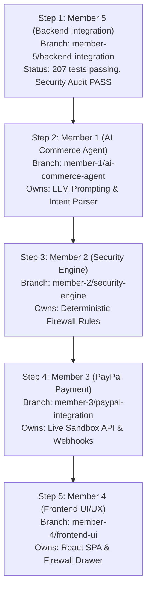

# IntentLock Commerce — Phase 3 Integration Readiness & API Contract Freeze

> **Document Status:** RATIFIED BASELINE & INTEGRATION SPECIFICATION (v2.0)  
> **Last Updated:** 2026-11-08  
> **Lead Maintainer:** Aditya Singh (`adityasing9`) — Member 5 (Backend Lead & Integrator)  
> **Target Audience:** Engineering Team (Members 1, 2, 3, 4, 5)  
> **Current Integration Branch:** `member-5/backend-integration`  
> **Baseline Verification:** 207 / 207 tests passing (16 test suites), ESLint 0 errors / 0 warnings, Independent Security Audit: FULL PASS.

---

## 1. Executive Summary & Integration Baseline

This document freezes the backend application programming interfaces (APIs), data contracts, and integration sequencing for **Phase 3 (Core Module Implementation & Integration)** of IntentLock Commerce.

All specifications herein reflect the **actual source code implementation** in `src/`, verified against automated test suites and the post-remediation security audit for Step 2.6 (`AUD-01` through `AUD-06`).

### External Dependency Status (Explicitly Unverified Gates)
To preserve engineering integrity, the following components remain tracked as **unverified external gates** and must not be described as production-verified until live credentials and infrastructure are connected:
1. **Real MongoDB Replica Set:** Current tests validate repository semantics and transactional mocks; multi-document ACID transactions across real distributed mongod daemons await Phase 4 cluster provisioning.
2. **Genuine PayPal Sandbox API:** Current payment workflows are validated via isolated mock adapters (`PayPalMockAdapter`); live OAuth2 token negotiation and `Orders v2` dispatch on `https://api-m.sandbox.paypal.com` await Member 3 credential provisioning.
3. **Genuine PayPal Webhook Cryptographic Verification:** Webhook processing fails closed with HTTP 501 `WEBHOOK_SIGNATURE_VERIFICATION_UNAVAILABLE` in non-mock environments until Member 3 integrates live X.509 RSA-SHA256 certificate verification.

---

## 2. Global Standards & Protocol Invariants

### 2.1 Network & Addressing
- **API Base URL:** `http://localhost:5000/api` (Configurable via `API_BASE_URL`)
- **Client Origin:** `http://localhost:3000` (Configurable via `APP_ORIGIN`)
- **Protocol:** HTTP/1.1 (Development/Test) / HTTPS (Staging/Production)
- **Transport Content-Type:** `application/json` (Payload limit: 100kb)
- **Raw Body Preservation:** Pristine raw buffer preserved on `req.rawBody` for webhook signature evaluation.

### 2.2 Monetary Representation & Arithmetic Standards
1. **Integer Minor Units:** All monetary sums are strictly represented as **64-bit integer minor units** (e.g., USD \$120.50 is represented as `"12050"` with exponent `2`).
2. **No Floating-Point Operations:** Floating-point numbers (`120.50`) are strictly banned in monetary database schemas, canonical hashes, and internal accounting.
3. **String Minor Units at Boundaries:** When submitted via API or serialized in JSON, monetary thresholds must use non-negative decimal integer strings (`"12050"`) to avoid 64-bit integer truncation in JavaScript engines.

### 2.3 Authentication, Session & Cookie Standards
1. **Session Cookie:** Authenticated sessions use an HTTP-only, Secure, `SameSite=Strict` cookie named `intentlock_session`.
2. **Cross-Site Navigation Invariant:** Standard browsers omit `SameSite=Strict` cookies during top-level cross-site GET redirects (such as returning from PayPal Sandbox). The application **never** assumes cookie presence on redirect landing routes.
3. **Token Revocation Check:** Every authenticated request validates `sessionVersion` against the primary database record. If `user.sessionVersion !== token.sessionVersion`, the session is terminated with HTTP 401 `SESSION_REVOKED`.

### 2.4 CSRF Architecture
1. **Header Requirement:** All state-mutating HTTP methods (`POST`, `PUT`, `DELETE`, `PATCH`) require the `X-CSRF-Token` header.
2. **HMAC-SHA256 Token Derivation:** Tokens are minted via `generateCsrfToken({ userId, sessionVersion, secret })` and validated via `verifyCsrfToken`.
3. **Anonymous Session Support:** Unauthenticated clients receive an `anonymous_session` CSRF token before login, allowing CSRF protection on registration and login endpoints.

### 2.5 Idempotency Standards
1. **Mandatory Header:** State-changing payment operations require `Idempotency-Key: <UUIDv4>`.
2. **Crash-Resilient Deduplication:** Re-submitting an existing `Idempotency-Key` returns the cached transaction response without initiating duplicate external API requests or state modifications.

### 2.6 Standard Response Envelopes

#### Success Envelope (200 OK / 201 Created)
```json
{
  "success": true,
  "data": {},
  "timestamp": "2026-11-08T18:00:00.000Z"
}
```

#### Error Envelope (4xx / 5xx)
```json
{
  "success": false,
  "error": {
    "code": "ERROR_CODE_STRING",
    "message": "Human-readable description of error condition.",
    "details": []
  },
  "timestamp": "2026-11-08T18:00:00.000Z"
}
```

---

## 3. Complete Frozen API Endpoint Directory

### 3.1 Authentication & Session Management

#### 3.1.1 Get CSRF Token
- **Endpoint:** `GET /api/auth/csrf`
- **Authentication:** Optional (`optionalAuth`)
- **CSRF Header:** Not required
- **Rate Limit:** 60 req/min (General)
- **Response (200 OK):**
```json
{
  "success": true,
  "data": {
    "csrfToken": "csrf_5f90a1b2c3d4e5f6a7b8c9d0e1f2a3b4"
  },
  "timestamp": "2026-11-08T18:00:00.000Z"
}
```

#### 3.1.2 User Registration
- **Endpoint:** `POST /api/auth/register`
- **Authentication:** None (Public)
- **CSRF Header:** Required (`X-CSRF-Token: <token>`)
- **Rate Limit:** 10 req/min per IP (`authLimiter`)
- **Validation Schema:** `registerSchema` (Zod)
  - `email`: string, valid email format, trimmed, lowercased
  - `password`: string, min 8 chars, 1 uppercase, 1 lowercase, 1 number
  - `name`: string, 1–100 characters, trimmed
- **Response (201 Created):**
  - **Set-Cookie:** `intentlock_session=<jwt>; Path=/; HttpOnly; Secure; SameSite=Strict; Max-Age=86400`
```json
{
  "success": true,
  "data": {
    "user": {
      "id": "672d1a2b8e34f190ab78c012",
      "email": "shopper@example.com",
      "name": "Jane Shopper",
      "role": "user"
    }
  },
  "timestamp": "2026-11-08T18:00:00.000Z"
}
```
- **Error Codes:** `CSRF_TOKEN_MISSING` (403), `CSRF_VALIDATION_FAILED` (403), `EMAIL_ALREADY_REGISTERED` (409), `VALIDATION_ERROR` (400).

#### 3.1.3 User Login
- **Endpoint:** `POST /api/auth/login`
- **Authentication:** None (Public)
- **CSRF Header:** Required (`X-CSRF-Token: <token>`)
- **Rate Limit:** 10 req/min per IP (`authLimiter`)
- **Validation Schema:** `loginSchema` (Zod)
  - `email`: string, valid email
  - `password`: string, non-empty
- **Response (200 OK):** Sets `intentlock_session` cookie; returns user profile object.
- **Error Codes:** `INVALID_CREDENTIALS` (401), `USER_INACTIVE` (401), `CSRF_TOKEN_MISSING` (403).

#### 3.1.4 User Logout
- **Endpoint:** `POST /api/auth/logout`
- **Authentication:** Required (`requireAuth`)
- **CSRF Header:** Required (`X-CSRF-Token: <token>`)
- **Behavior:** Increments `user.sessionVersion` in DB (invalidating all active JWTs globally) and clears the `intentlock_session` cookie.
- **Response (200 OK):**
```json
{
  "success": true,
  "data": {
    "message": "Logged out successfully"
  },
  "timestamp": "2026-11-08T18:00:00.000Z"
}
```

#### 3.1.5 Get Current User Profile
- **Endpoint:** `GET /api/auth/me`
- **Authentication:** Required (`requireAuth`)
- **CSRF Header:** Not required
- **Response (200 OK):**
```json
{
  "success": true,
  "data": {
    "user": {
      "id": "672d1a2b8e34f190ab78c012",
      "email": "shopper@example.com",
      "name": "Jane Shopper",
      "role": "user"
    }
  },
  "timestamp": "2026-11-08T18:00:00.000Z"
}
```

---

### 3.2 User Preferences Management

#### 3.2.1 Get Preferences
- **Endpoint:** `GET /api/user/preferences`
- **Authentication:** Required (`requireAuth`)
- **CSRF Header:** Not required
- **Behavior:** Lazily seeds default preferences if record does not yet exist.
- **Response (200 OK):**
```json
{
  "success": true,
  "data": {
    "defaultCurrency": "USD",
    "minorUnitExponent": 2,
    "maxTransactionLimitMinor": "50000",
    "dailySpendingLimitMinor": "100000",
    "allowedMerchants": ["MERCHANT_KEYCHRON", "MERCHANT_LOGITECH", "MERCHANT_BESTBUY"],
    "blockedMerchants": ["MERCHANT_SHADY_DEALS"],
    "requireExplicitReviewOverMinor": "20000"
  },
  "timestamp": "2026-11-08T18:00:00.000Z"
}
```

#### 3.2.2 Update Preferences
- **Endpoint:** `PUT /api/user/preferences`
- **Authentication:** Required (`requireAuth`)
- **CSRF Header:** Required (`X-CSRF-Token: <token>`)
- **Validation Schema:** `updatePreferencesSchema` (Zod)
  - `defaultCurrency`: string, ISO-4217 3-letter code (optional)
  - `minorUnitExponent`: integer, 0–4 (optional)
  - `maxTransactionLimitMinor`: decimal integer string (optional)
  - `allowedMerchants`: array of strings (optional)
  - `blockedMerchants`: array of strings (optional)
  - `requireExplicitReviewOverMinor`: decimal integer string (optional)
- **Response (200 OK):** Returns updated preference object.

---

### 3.3 Product Catalog Discovery

#### 3.3.1 List Products
- **Endpoint:** `GET /api/products`
- **Authentication:** Public
- **CSRF Header:** Not required
- **Query Parameters:**
  - `category`: string (optional, e.g., `Keyboards`, `Headphones`, `Monitors`)
  - `q`: string (optional, text search keyword)
- **Response (200 OK):**
```json
{
  "success": true,
  "data": {
    "products": [
      {
        "externalId": "prod_k2_pro",
        "title": "Keychron K2 Pro Wireless Mechanical Keyboard",
        "description": "Custom mechanical keyboard with tactile switches.",
        "category": "Keyboards",
        "merchantId": "MERCHANT_KEYCHRON",
        "merchantName": "Keychron Official Store",
        "paypalMerchantId": "PPM_KEYCHRON_998",
        "basePriceMinor": "9900",
        "currency": "USD",
        "minorUnitExponent": 2,
        "specifications": {
          "connectivity": "Wireless",
          "switchType": "Tactile",
          "backlight": "White LED"
        }
      }
    ],
    "total": 1
  },
  "timestamp": "2026-11-08T18:00:00.000Z"
}
```

#### 3.3.2 Get Product by External ID
- **Endpoint:** `GET /api/products/:id`
- **Authentication:** Public
- **Response (200 OK):** `{ "success": true, "data": { "product": { ... } } }`
- **Error Codes:** `PRODUCT_NOT_FOUND` (404).

---

### 3.4 Shopping Intents Management

#### 3.4.1 Create Intent
- **Endpoint:** `POST /api/intents`
- **Authentication:** Required (`requireAuth`)
- **CSRF Header:** Required (`X-CSRF-Token: <token>`)
- **Rate Limit:** 60 req/min
- **Validation Schema:** `createIntentSchema` (Zod)
  - `prompt`: string, 1–1000 characters
  - `maxBudgetMinor`: decimal integer string (e.g., `"12000"`)
  - `currency`: ISO-4217 uppercase 3-letter code (`"USD"`)
  - `minorUnitExponent`: integer, 0–4 (default `2`)
  - `category`: enum (`Keyboards`, `Headphones`, `Monitors`) (optional)
  - `constraints`: object containing `requiredSpecs`, `preferredMerchants`, `blockedMerchants`
- **Request Body Example:**
```json
{
  "prompt": "Wireless mechanical keyboard with tactile switches under $120",
  "maxBudgetMinor": "12000",
  "currency": "USD",
  "minorUnitExponent": 2,
  "category": "Keyboards",
  "constraints": {
    "requiredSpecs": {
      "connectivity": "Wireless",
      "switchType": "Tactile"
    }
  }
}
```
- **Response (201 Created):**
```json
{
  "success": true,
  "data": {
    "intentId": "672d1a2b8e34f190ab78c055",
    "version": 1,
    "prompt": "Wireless mechanical keyboard with tactile switches under $120",
    "maxBudgetMinor": "12000",
    "currency": "USD",
    "minorUnitExponent": 2,
    "category": "Keyboards",
    "constraints": {
      "requiredSpecs": { "connectivity": "Wireless", "switchType": "Tactile" },
      "preferredMerchants": [],
      "blockedMerchants": []
    },
    "status": "INITIALIZED",
    "createdAt": "2026-11-08T18:05:00.000Z"
  },
  "timestamp": "2026-11-08T18:05:00.000Z"
}
```

#### 3.4.2 List User Intents
- **Endpoint:** `GET /api/intents`
- **Authentication:** Required (`requireAuth`)
- **Response (200 OK):** `{ "success": true, "data": { "intents": [...] } }`

#### 3.4.3 Get Intent by ID
- **Endpoint:** `GET /api/intents/:id`
- **Authentication:** Required (`requireAuth`, verifies user ownership)
- **Response (200 OK):** Returns single intent object.
- **Error Codes:** `INTENT_NOT_FOUND` (404).

---

### 3.5 Product Proposals Management

#### 3.5.1 Create Proposal
- **Endpoint:** `POST /api/proposals`
- **Authentication:** Internal / Service-to-Service (AI Agent Adapter)
- **CSRF Header:** Not required
- **Validation Schema:** `createProposalSchema` (Zod)
  - Validates full commercial line items, prices, recurring terms, and arithmetic integrity (`base + shipping + tax - discount === total`).
- **Request Body Example:**
```json
{
  "intentId": "672d1a2b8e34f190ab78c055",
  "productId": "prod_k2_pro",
  "variantSku": "K2P-WHT-TAC-BROWN",
  "title": "Keychron K2 Pro Wireless Mechanical Keyboard",
  "merchant": {
    "id": "MERCHANT_KEYCHRON",
    "name": "Keychron Official Store",
    "paypalMerchantId": "PPM_KEYCHRON_998"
  },
  "lineItems": [
    {
      "name": "Keychron K2 Pro (Brown Switch)",
      "sku": "K2P-WHT-TAC-BROWN",
      "quantity": 1,
      "unitPriceMinor": "9900"
    }
  ],
  "pricing": {
    "basePriceMinor": "9900",
    "shippingMinor": "1000",
    "taxMinor": "890",
    "discountMinor": "0",
    "totalPriceMinor": "11790",
    "currency": "USD",
    "minorUnitExponent": 2
  },
  "specifications": {
    "connectivity": "Wireless",
    "switchType": "Tactile",
    "backlight": "White LED"
  },
  "recurring": {
    "isRecurring": false,
    "billingInterval": null,
    "billingCycles": 0
  },
  "catalogSource": "CHANNEL3_OFFLINE_FIXTURE",
  "productUrl": "https://www.keychron.com/products/keychron-k2-pro",
  "recommendationRank": 1
}
```
- **Response (201 Created):**
```json
{
  "success": true,
  "data": {
    "proposalId": "672d1a2b8e34f190ab78c099",
    "intentId": "672d1a2b8e34f190ab78c055",
    "snapshotId": "672d1a2b8e34f190ab78c0aa",
    "snapshotHash": "4a7d2e8b91c2...64_hex_sha256",
    "totalPriceMinor": "11790",
    "currency": "USD",
    "status": "PENDING_VERIFICATION",
    "createdAt": "2026-11-08T18:06:00.000Z"
  },
  "timestamp": "2026-11-08T18:06:00.000Z"
}
```

#### 3.5.2 Get Proposal by ID
- **Endpoint:** `GET /api/proposals/:id`
- **Authentication:** Public / Authenticated
- **Response (200 OK):** Returns proposal details along with bound `snapshotId` and `snapshotHash`.

---

### 3.6 Security Firewall Verification

#### 3.6.1 Evaluate Proposal & Generate Ed25519 Authorization
- **Endpoint:** `POST /api/security/verify`
- **Authentication:** Required (`requireAuth`)
- **CSRF Header:** Not required (Read-only verification query; no financial state mutated)
- **Validation Schema:** `verifyProposalSchema` (Zod)
- **Request Body:**
```json
{
  "intent": {
    "id": "672d1a2b8e34f190ab78c055",
    "version": 1,
    "maxBudgetMinor": "12000",
    "currency": "USD",
    "minorUnitExponent": 2,
    "requiredSpecs": {
      "connectivity": "Wireless",
      "switchType": "Tactile"
    }
  },
  "snapshot": {
    "snapshotId": "672d1a2b8e34f190ab78c0aa",
    "snapshotHash": "4a7d2e8b91c2...64_hex_sha256",
    "proposalId": "672d1a2b8e34f190ab78c099",
    "productId": "prod_k2_pro",
    "variantSku": "K2P-WHT-TAC-BROWN",
    "merchantId": "MERCHANT_KEYCHRON",
    "paypalMerchantId": "PPM_KEYCHRON_998",
    "lineItems": [
      {
        "name": "Keychron K2 Pro",
        "sku": "K2P-WHT-TAC-BROWN",
        "quantity": 1,
        "unitPriceMinor": "9900"
      }
    ],
    "pricing": {
      "basePriceMinor": "9900",
      "shippingMinor": "1000",
      "taxMinor": "890",
      "discountMinor": "0",
      "totalPriceMinor": "11790",
      "currency": "USD",
      "minorUnitExponent": 2
    },
    "recurring": {
      "isRecurring": false,
      "billingCycles": 0
    },
    "specifications": {
      "connectivity": "Wireless",
      "switchType": "Tactile"
    },
    "rawDescription": "Keychron K2 Pro Wireless Mechanical Keyboard."
  },
  "acknowledgedReviewDiffs": []
}
```

##### Outcome 1: PASS (All Rules Satisfied)
```json
{
  "success": true,
  "data": {
    "decision": "PASS",
    "riskScore": 0.02,
    "ruleEvaluations": {
      "snapshotIntegrityCheck": { "passed": true, "snapshotHash": "4a7d...64_hex" },
      "budgetCheck": { "passed": true, "deltaMinor": -210 },
      "merchantCheck": { "passed": true, "payeeStatus": "VERIFIED_WHITELIST" },
      "recurringCheck": { "passed": true, "isRecurring": false },
      "specCheck": { "passed": true, "mismatches": [] },
      "contentCheck": { "status": "PASSIVE_DATA_CONFIRMED" }
    },
    "authorization": {
      "authorizationId": "auth_4402a11c89f2130e",
      "algorithm": "Ed25519",
      "canonicalJsonHash": "d5a8...32_byte_sha256_hex",
      "publicKey": "a1b2c3d4...32_byte_hex",
      "nonce": "7f8a9b0c...256_bit_hex",
      "issuedAt": "2026-11-08T18:07:00.000Z",
      "expiresAt": "2026-11-08T18:12:00.000Z",
      "validitySeconds": 300,
      "signature": "3e9b1c7f...64_byte_ed25519_hex"
    }
  },
  "timestamp": "2026-11-08T18:07:00.000Z"
}
```

##### Outcome 2: REVIEW (Non-Critical Specification Delta)
```json
{
  "success": true,
  "data": {
    "decision": "REVIEW",
    "reviewReason": "SPECIFICATION_MISMATCH",
    "riskScore": 0.25,
    "specDifferences": [
      {
        "attribute": "backlight",
        "requested": "RGB",
        "proposed": "White LED",
        "criticality": "NON_CRITICAL"
      }
    ],
    "ruleEvaluations": {
      "snapshotIntegrityCheck": { "passed": true },
      "budgetCheck": { "passed": true },
      "merchantCheck": { "passed": true },
      "recurringCheck": { "passed": true }
    },
    "requiresExplicitUserConfirmation": true,
    "authorization": null
  },
  "timestamp": "2026-11-08T18:07:00.000Z"
}
```

##### Outcome 3: BLOCK (Definitive Security Violation)
```json
{
  "success": true,
  "data": {
    "decision": "BLOCK",
    "errorCode": "CRITICAL_VIOLATION_MERCHANT_MISMATCH",
    "reason": "Policy check failed: CRITICAL_VIOLATION_MERCHANT_MISMATCH",
    "riskScore": 0.95,
    "ruleEvaluations": {
      "merchantCheck": {
        "passed": false,
        "detectedMerchant": "PPM_ROGUE_881",
        "expectedMerchant": "PPM_KEYCHRON_998"
      }
    },
    "authorization": null
  },
  "timestamp": "2026-11-08T18:07:00.000Z"
}
```

---

### 3.7 Payment Lifecycle Endpoints

```mermaid
sequenceDiagram
    autonumber
    actor User as Buyer (Browser / SPA)
    participant Front as Frontend Client (Member 4)
    participant Back as Backend REST API (Member 5)
    participant PP as PayPal Sandbox (Member 3)

    Note over Front,Back: Step 1: Order Creation
    Front->>Back: POST /api/payments/create-order (Idempotency-Key, CSRF, userConsent: true)
    Back->>Back: Verify Ed25519 Auth & Nonce (PENDING -> IN_FLIGHT)
    Back->>PP: Create Order (PayPal-Request-Id)
    PP-->>Back: orderId, approvalUrl
    Back-->>Front: approvalUrl, orderId

    Note over User,PP: Step 2: Buyer Approval
    User->>PP: Approves Payment on PayPal

    alt Cross-Site Redirect Navigation Flow
        PP->>Back: GET /api/payments/return?token=ORDER_ID&return_token=RET_TOK
        Note over Back: Trampoline: NEVER captures funds; NEVER consumes token
        Back-->>User: 302 Redirect: ${APP_ORIGIN}/checkout/return?orderId=...#return_token=...
        User->>Front: Loads SPA Return View
        Front->>Front: Extracts fragment, strips via history.replaceState
        Front->>Back: POST /api/payments/recover-session { orderId, returnToken }
        Note over Back: Atomic Token Consumption: PENDING -> CONSUMED. Re-issues session cookie
        Back-->>Front: Session Recovered (Ready for capture)
    end

    Note over Front,Back: Step 3: Explicit Final Capture
    Front->>Back: POST /api/payments/capture-order (Idempotency-Key, CSRF, orderId, authorizationId)
    Back->>Back: Assert matchesAuth (Fails before PayPal call if mismatch)
    Back->>PP: Capture Order (PayPal-Request-Id)
    PP-->>Back: captureId, status: COMPLETED
    Back->>Back: Finalize PaymentTransaction (COMPLETED) & Invalidate Auth Nonce
    Back-->>Front: Receipt & Captured Details
```

#### 3.7.1 Create PayPal Order
- **Endpoint:** `POST /api/payments/create-order`
- **Authentication:** Required (`requireAuth`)
- **CSRF Header:** Required (`X-CSRF-Token: <token>`)
- **Idempotency Header:** Required (`Idempotency-Key: <uuid_v4>`)
- **Rate Limit:** 10 req/min (`paymentLimiter`)
- **Validation Schema:** `createOrderSchema` (Zod)
  - `proposalId`: string
  - `authorizationId`: string (resolves to MongoDB ObjectId or business string)
  - `userConsent`: literal `true` (strictly required)
  - `acknowledgedReviewDiffs`: array of strings (optional, default `[]`)
- **Security Invariants:**
  1. Validates `userConsent === true`.
  2. Resolves authorization record from DB; verifies `authRecord.userId === req.user._id` (rejects cross-user usage with 403 `USER_MISMATCH`).
  3. Verifies `authRecord.proposalId === proposalId` (rejects proposal mismatch with 400 `PROPOSAL_ID_MISMATCH`).
  4. Verifies `authRecord.intentVersion === intentDoc.version` (rejects concurrent intent mutation with 400 `INTENT_VERSION_MISMATCH`).
  5. Cryptographically verifies Ed25519 signature over RFC 8785 canonical hash.
  6. Enforces 5-minute expiry (`now < expiresAt`).
  7. Transitions authorization status `PENDING` $\to$ `IN_FLIGHT`.
  8. Passes `PayPal-Request-Id: <idempotencyKey>` to PayPal Orders API.
  9. Mints single-use ephemeral return token with 15-minute TTL.
- **Response (201 Created):**
```json
{
  "success": true,
  "data": {
    "orderId": "PAYPAL_ORDER_88392104A1B2",
    "status": "CREATED",
    "amountMinor": "11790",
    "currency": "USD",
    "minorUnitExponent": 2,
    "approvalUrl": "https://www.sandbox.paypal.com/checkoutnow?token=PAYPAL_ORDER_88392104A1B2",
    "returnToken": "ret_tok_a1b2c3d4e5f67890"
  },
  "timestamp": "2026-11-08T18:08:00.000Z"
}
```

#### 3.7.2 Capture PayPal Order
- **Endpoint:** `POST /api/payments/capture-order`
- **Authentication:** Required (`requireAuth`)
- **CSRF Header:** Required (`X-CSRF-Token: <token>`)
- **Idempotency Header:** Required (`Idempotency-Key: <uuid_v4>`)
- **Rate Limit:** 10 req/min (`paymentLimiter`)
- **Validation Schema:** `captureOrderSchema` (Zod)
  - `orderId`: string
  - `authorizationId`: string
- **Security Invariants:**
  1. Resolves transaction by `orderId` and verifies `tx.userId === req.user._id`.
  2. **Pre-Capture Authorization Assertion:** Validates supplied `authorizationId` against stored `tx.authorizationId` and `authRecord.authorizationId`. Any mismatch immediately throws HTTP 400 `AUTHORIZATION_ID_MISMATCH` **before calling PayPal Capture API and before checking idempotency**.
  3. **Idempotent Retries:** If transaction is already `COMPLETED`, returns stored capture receipt without calling PayPal twice.
  4. Calls PayPal Capture v2 API with `PayPal-Request-Id: <idempotencyKey>`.
  5. Transitions authorization status `IN_FLIGHT` $\to$ `CONSUMED`.
  6. Finalizes transaction record to `COMPLETED`.
- **Response (200 OK):**
```json
{
  "success": true,
  "data": {
    "captureId": "CAP_99182371F4E2",
    "status": "COMPLETED",
    "transactionId": "672d1a2b8e34f190ab78c0ee",
    "finalAmountMinor": "11790",
    "currency": "USD",
    "payerEmail": "buyer@sandbox.paypal.com",
    "capturedAt": "2026-11-08T18:09:30.000Z"
  },
  "timestamp": "2026-11-08T18:09:30.000Z"
}
```

#### 3.7.3 PayPal Return Redirect Trampoline
- **Endpoint:** `GET /api/payments/return`
- **Authentication:** Public (Cross-site browser navigation from PayPal)
- **CSRF Header:** Not required
- **Query Parameters:**
  - `token` or `orderId`: string (PayPal Order ID)
  - `return_token`: string (Single-use ephemeral token)
- **CRITICAL SECURITY INVARIANTS:**
  1. **Zero Fund Capture:** This route **never** contacts PayPal capture endpoints and **never** captures funds.
  2. **Zero Token Consumption:** This route **never** calls `recoverReturnSession` or `consumeReturnToken`. The return token state remains `PENDING` in the database throughout the redirect.
  3. **URL Fragment Transfer:** Issues an HTTP 302 redirect transferring the return token to the SPA landing page strictly inside the URL fragment:
     `${APP_ORIGIN}/checkout/return?orderId=${orderId}#return_token=${returnToken}`
  4. **Referrer-Policy Protection:** Sets `Referrer-Policy: strict-origin-when-cross-origin` to block token leakage across third-party referrers.
- **Browser Response:** HTTP 302 Redirect.
- **Headless/JSON Response (Accept: application/json):**
```json
{
  "success": true,
  "data": {
    "message": "Return redirect validated. Transferring token to SPA via URL fragment.",
    "orderId": "PAYPAL_ORDER_88392104A1B2",
    "redirectUrl": "http://localhost:3000/checkout/return?orderId=PAYPAL_ORDER_88392104A1B2#return_token=ret_tok_a1b2c3d4e5f67890"
  },
  "timestamp": "2026-11-08T18:09:00.000Z"
}
```

#### 3.7.4 Recover Return Session
- **Endpoint:** `POST /api/payments/recover-session`
- **Authentication:** Public / Same-Site SPA
- **CSRF Header:** Not required (Used to bootstrap session recovery after cross-site navigation)
- **Rate Limit:** General API limiter
- **Validation Schema:** `recoverSessionSchema` (Zod)
  - `orderId`: string
  - `returnToken`: string
- **CRITICAL SECURITY INVARIANTS:**
  1. **Sole Atomic Consumer:** This endpoint is the **only** entry point that transitions the return token from `PENDING` to `CONSUMED`.
  2. **Single-Use Atomic MongoDB Lock:** Executes `findOneAndUpdate` with `{ returnToken, 'returnTokenMetadata.consumed': false, 'returnTokenMetadata.expiresAt': { $gt: now } }`. Replay attempts fail immediately with HTTP 401 `INVALID_OR_EXPIRED_RETURN_TOKEN`.
  3. **Zero Trust in Client Identity:** Reads `tx.userId` directly from the database transaction record. Re-issues session cookie exclusively for `tx.userId`.
  4. **Zero Fund Capture:** Recovers session context only; **never** captures funds.
- **Response (200 OK):**
  - **Set-Cookie:** Re-issues HTTP-only `intentlock_session` cookie for verified `tx.userId`.
```json
{
  "success": true,
  "data": {
    "message": "Session context recovered successfully. Ready for explicit capture confirmation.",
    "orderId": "PAYPAL_ORDER_88392104A1B2",
    "status": "CREATED",
    "amountMinor": "11790",
    "currency": "USD"
  },
  "timestamp": "2026-11-08T18:09:15.000Z"
}
```

#### 3.7.5 PayPal Webhook Ingestion
- **Endpoint:** `POST /api/payments/webhooks`
- **Authentication:** Public (Signature Verified)
- **CSRF Header:** Not required
- **Required Headers:**
  - `paypal-auth-algo`: string (e.g., `SHA256withRSA`)
  - `paypal-cert-url`: string (HTTPS URL strictly pointing to `api.paypal.com` or `api.sandbox.paypal.com` on port 443)
  - `paypal-transmission-id`: string
  - `paypal-transmission-sig`: string
  - `paypal-transmission-time`: string
- **Security Invariants:**
  1. **SSRF Defense:** Evaluates `paypal-cert-url` protocol, host, and port before making outbound requests. Rejects all other subdomains, IP literals, non-443 ports, private/loopback IPs, and redirects.
  2. **Mock Webhook Quarantine:** Rejects `x-intentlock-mock-webhook` in production with HTTP 403 `MOCK_WEBHOOK_REJECTED`.
  3. **Production Fail-Closed Gate:** In non-mock environments, throws HTTP 501 `WEBHOOK_SIGNATURE_VERIFICATION_UNAVAILABLE` until live X.509 verification is wired by Member 3.
  4. **Deduplication:** Deduplicates incoming events using unique index on `paypalEventId`.
- **Response (200 OK):**
```json
{
  "received": true,
  "eventId": "WH-99210-EVENT",
  "status": "VERIFIED_AND_PROCESSED"
}
```

---

## 4. Return vs. Recovery vs. Capture Triad (Non-Negotiable Invariants)

| Dimension | `GET /api/payments/return` | `POST /api/payments/recover-session` | `POST /api/payments/capture-order` |
| :--- | :--- | :--- | :--- |
| **Primary Purpose** | Redirect trampoline from PayPal to SPA | Re-establishes session cookie for buyer | Executes financial capture on PayPal |
| **Consumes Return Token?** | **NO** (Token remains `PENDING`) | **YES** (Sole atomic consumer; single-use) | **N/A** (Token already consumed) |
| **Captures Funds?** | **NEVER** | **NEVER** | **YES** (Authoritative financial step) |
| **Session Cookie Minted?** | **NO** (Passes token via URL fragment) | **YES** (Minted strictly for DB `tx.userId`) | **NO** (Preserves active session) |
| **Authentication Required?** | Public navigation | Public body credentials (`orderId`, `token`) | Authenticated (`requireAuth`) |
| **CSRF Required?** | No | No | Yes (`X-CSRF-Token`) |
| **Idempotency Key Required?** | No | No | Yes (`Idempotency-Key`) |
| **Replay Behavior** | Idempotent redirect generation | Fails with HTTP 401 on 2nd attempt | Returns cached capture receipt |

---

## 5. Integration Order & Dependency Map

To guarantee zero merge conflicts and preserve the Step 2.6 security baseline, PRs must be merged into `main` in the following sequence.



### Step 1: Base Integration — Member 5 (`member-5/backend-integration`)
- **Status:** Complete & Frozen.
- **Files Owned:** Core Express app, Mongoose models, repositories, routes, controllers, middleware, Zod schemas, utilities, offline catalog fixture.
- **Test Gate:** All 207 tests pass; ESLint 0 errors / 0 warnings.
- **Role:** Forms the authoritative foundation that all other members rebase upon.

### Step 2: AI Agent Integration — Member 1 (`member-1/ai-commerce-agent`)
- **Dependencies:** Member 5 foundation.
- **Files Owned:** `src/adapters/aiAgentAdapter.js` (replacing mock with live LLM client or structured generator), prompt engineering templates.
- **Forbidden Files:** Must not touch `src/services/PayPalService.js`, `src/services/SecurityFirewallService.js`, or `src/models/`.
- **Review Gate:** Ensure AI output strictly maps to `createProposalSchema` and has zero payment privileges.

### Step 3: Security Engine Integration — Member 2 (`member-2/security-engine`)
- **Dependencies:** Member 5 foundation, Member 1 proposal schemas.
- **Files Owned:** `src/adapters/securityEngineAdapter.js`, rule evaluation algorithms.
- **Forbidden Files:** Must not create duplicate firewall services. Must reuse `SecurityFirewallService.js`, `canonicalJson.js`, and `cryptoUtils.js`.
- **Review Gate:** Verify Rule 0 snapshot immutability, Ed25519 canonical signing, and ensure hard constraints (budget, payee, recurring) cannot be waived.

### Step 4: PayPal Payment Integration — Member 3 (`member-3/paypal-integration`)
- **Dependencies:** Member 5 backend, Member 2 signed authorization packets.
- **Files Owned:** `src/adapters/paypalMockAdapter.js`, PayPal OAuth2 client, genuine X.509 webhook verification.
- **Forbidden Files:** Must not modify return-token recovery logic or bypass `matchesAuth` pre-capture assertions.
- **Review Gate:** Live PayPal Sandbox testing; verify raw request body signature validation; fail-closed webhook gate.

### Step 5: Frontend UI/UX Integration — Member 4 (`member-4/frontend-ui`)
- **Dependencies:** Full backend REST API (`localhost:5000/api`).
- **Files Owned:** `client/` or `frontend/` directory (React application, Tailwind CSS, UI components).
- **Forbidden Files:** Must not modify backend security logic.
- **Review Gate:** End-to-end user journey from search to inspection drawer diff confirmation, return trampoline fragment removal, and receipt rendering.

---

## 6. Rollback Strategy & Emergency Procedures

1. **Feature Flag Isolation:** Live adapters are toggled via environment variables (`USE_MOCK_SECURITY`, `USE_MOCK_PAYPAL`). If an integrated external adapter fails in staging, revert the toggle back to mock mode.
2. **Git Revert Protocol:** If a merged PR introduces regressions into `main`, execute `git revert -m 1 <merge_commit_sha>`. Do not rewrite Git history with force-push.
3. **Database Migration Safety:** All Mongoose schemas utilize non-destructive additions. No schema drop or destructive index removal is permitted during Phase 3.
