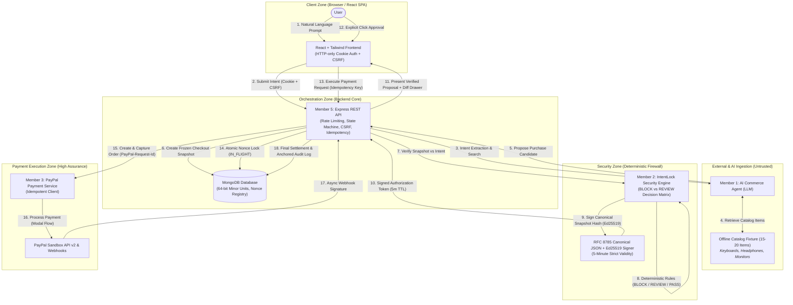
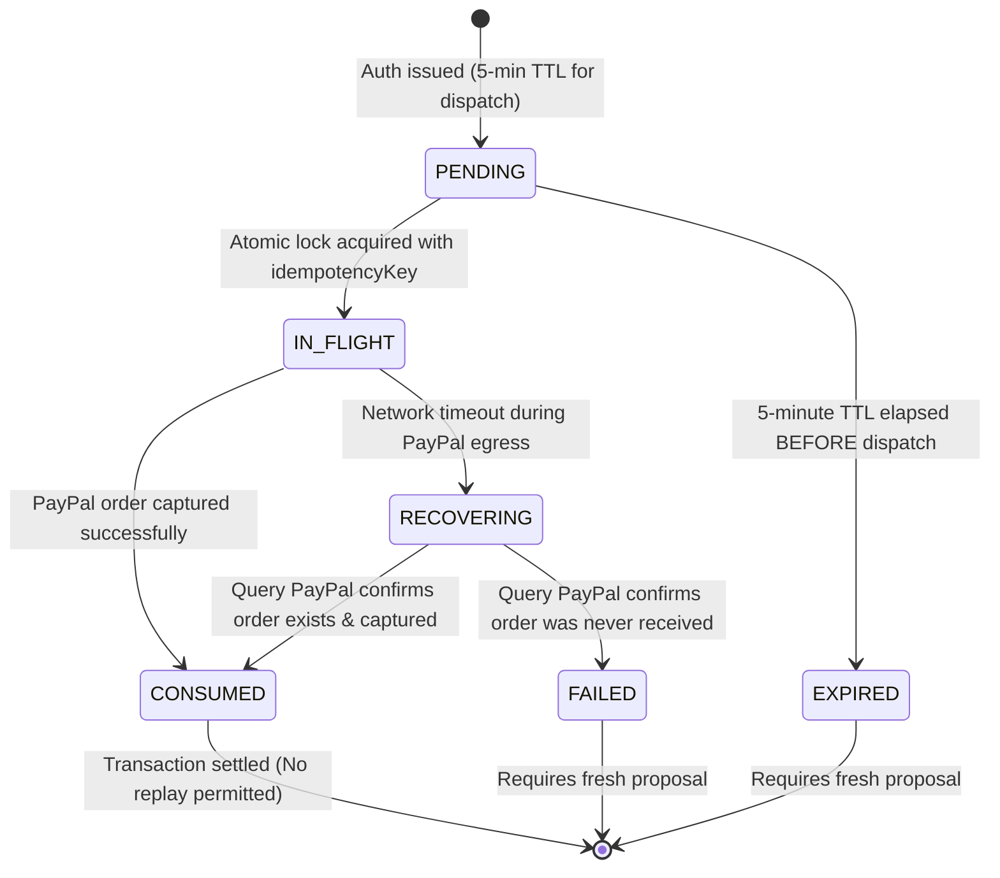

# IntentLock Commerce — Project Architecture

> **Document Status:** CONFIRMED BASELINE (v1.2)  
> **Last Updated:** 2026-11-07  
> **Component Lead:** Aditya Singh (`adityasing9`) — Member 5  

---

## 1. Architectural Vision

**IntentLock Commerce** is an agentic e-commerce platform equipped with an independent payment security firewall. The architecture decouples the creative, probabilistic discovery capabilities of Large Language Models (LLMs) from the deterministic, high-assurance constraints required for financial transactions.

---

## 2. Trust Boundaries & Security Zoning

The system is partitioned into five distinct trust zones:

| Trust Zone | Components | Security Classification | Assumptions & Controls |
|---|---|---|---|
| **1. Untrusted Zone** | External APIs, Product Pages, Scraped Web Content, LLM Outputs | **Untrusted** | Assumed to be susceptible to prompt injection, pricing deception, and format manipulation. Product text is treated strictly as passive data. **Suspicious text alone does not block legitimate products**; a `BLOCK` occurs only upon a defined policy violation. |
| **2. Client Zone** | React SPA, Web Browser, Local Storage | **Semi-Trusted** | Client code runs on the user's device. Authenticated via **HTTP-only, Secure, `SameSite=Strict` cookies**; state-changing requests enforce `X-CSRF-Token`. Requires explicit test coverage for PayPal return flows. |
| **3. Orchestration Zone** | Node.js Express REST API, MongoDB Database | **Trusted** | Owns session state, intent versioning, snapshot freezing, rate limiting (60 req/min baseline), crash recovery, and transaction lifecycles. |
| **4. Security Zone** | IntentLock Policy Engine, Ed25519 Signing Vault | **Isolated High Trust** | Operates strictly on deterministic logic. Houses the Ed25519 private signing key. Evaluates hard constraints (budget, merchant ID, spec delta, recurring fees). AI confidence scores *cannot* override security rules. |
| **5. Payment Execution Zone** | PayPal REST Client, PayPal Sandbox, Webhook Handler | **High Assurance** | Interacts directly with PayPal APIs. Strictly checks that a valid, unexpired (5-minute), signed authorization token exists. Guarantees safe recovery for `IN_FLIGHT` orders without duplicate charges. |

---

## 3. End-to-End Transaction Flow

### Phase 1: Intent Registration & Versioning
1. User enters natural-language request: *"Buy a wireless mechanical keyboard, tactile switches, white backlight, budget \$120."*
2. Rate-limiter checks request (baseline: 60 req/min/IP, with authenticated `userId` tracking).
3. Frontend sends request to `POST /api/intents` with CSRF token and session cookie.
4. Backend records a new `PaymentIntent` in MongoDB at `version: 1`, locking the user's spending ceiling (\$120.00 = `12000` minor units for USD).

### Phase 2: AI Discovery & Proposal Formulation
5. Member 1's AI Commerce Agent searches the verified offline catalog fixture (15–20 products across keyboards, headphones, monitors) and ranks matching candidates.
6. AI Agent submits a structured proposal to `POST /api/proposals`.
7. Backend freezes an immutable `CheckoutSnapshot` containing:
   - Product ID, title, and exact variant SKU
   - Merchant ID and verified PayPal payee merchant ID
   - Line items (item metadata, quantity, unit price)
   - Price breakdown: base price, shipping, tax, discounts, and total amount
   - Currency code and minor-unit exponent
   - Recurring charge flags (`isRecurring: false`, billing cycles: 0)

### Phase 3: Independent Deterministic Verification
8. Backend dispatches the frozen snapshot and intent constraints to Member 2's Security Engine via `POST /api/security/verify`.
9. The Security Engine evaluates non-probabilistic policy rules:
   - **Critical Violations (Mandatory `BLOCK`):**
     - **Budget Exceeded:** `totalPriceMinor > maxBudgetMinor`
     - **Merchant Mismatch:** Payee ID does not match whitelisted/approved merchant directory
     - **Recurring Charges:** Proposal contains recurring billing agreements or installment plans
     - **Prompt Injection:** Injections attempting to manipulate structured policy inputs
   - **Non-Critical Mismatches (`REVIEW`):**
     - **Spec Delta:** Core attributes match, but non-critical features differ (e.g., keyboard switch color differs from prompt). Marked `REVIEW`, requiring explicit user acknowledgment of the diff.
   - **Passive Untrusted Text:** Descriptive catalog text is treated as passive data. Detecting suspicious text alone does not block a product unless a policy rule is violated.
   - **All Rules Satisfied (`PASS`):** Transaction cleared for cryptographic signing.

### Phase 4: RFC 8785 Canonical JSON & Ed25519 Authorization
10. Upon `PASS` (or user-confirmed `REVIEW`), the Security Engine generates an authorization packet:
    - Generates a unique 256-bit cryptographically secure random `nonce`.
    - Sets validity window to **exactly 5 minutes** (`expiresAt = now + 300s`).
    - Normalizes the complete authorization payload into canonical JSON per **RFC 8785**.
    - Computes the SHA-256 digest of the canonical JSON string.
    - Signs the 32-byte digest using the isolated private **Ed25519** key.
    - Stores the authorization in `authorization_records` with status `PENDING`.

### Phase 5: Explicit User Approval
11. Backend returns the verified proposal, diff breakdown (if `REVIEW`), and authorization ID to the React frontend.
12. Frontend renders the **IntentLock Security Inspection Drawer**:
    - If `REVIEW`, displays a side-by-side comparison of requested vs. proposed specifications.
    - Displays exact item specs, line items, merchant badge, and countdown timer (5-minute expiry).
13. User clicks an explicit **"Approve & Pay via PayPal"** button. The AI agent has zero capability to trigger this action.

### Phase 6: Crash-Resilient Payment Execution via PayPal Sandbox
14. Frontend calls `POST /api/payments/create-order` passing `proposalId`, `authorizationId`, and a client-generated `idempotencyKey`.
15. Backend verifies the authorization:
    - Verifies Ed25519 signature against the Security Engine public key.
    - Confirms `now < expiresAt` (for *new* dispatches).
    - Executes atomic lock: `PENDING` $\longrightarrow$ `IN_FLIGHT`.
16. Backend calls PayPal Orders REST API v2 with `PayPal-Request-Id: <idempotencyKey>`.
17. Frontend renders PayPal SDK modal; user completes payment without leaving parent window (preserving `SameSite=Strict` cookies).
18. Backend captures payment via `POST /api/payments/capture-order` and updates authorization to `CONSUMED`.

### Phase 7: Webhook Audit & Dual-Trigger External Anchoring
19. PayPal dispatches `PAYMENT.CAPTURE.COMPLETED` webhook.
20. Backend verifies PayPal certificate transmission signatures, deduplicates via `webhook_events`, marks transaction `COMPLETED`, and appends an entry to `audit_logs`.
21. Root audit log chain tip is anchored externally every **60 minutes**, plus **immediately** after any transaction exceeding `HIGH_VALUE_ANCHOR_THRESHOLD_MINOR` (default: 20000 = \$200.00).

---

## 4. Crash Recovery & Idempotent Nonce Reconciliation

### Distinct Nonce Lifecycles: Expiry vs. In-Flight Recovery
1. **New Payment Dispatches:** If the 5-minute validity window expires before a payment is dispatched, the authorization cannot be used to start a new order.
2. **In-Flight Crash Recovery:** If a payment entered `IN_FLIGHT` and was interrupted by a network timeout or server restart, **it remains recoverable via its original `idempotencyKey` and `authorizationId`**, even if the 5-minute client window elapses during recovery.
   - **Safety Invariant:** Recovery binds strictly to the existing PayPal order via `PayPal-Request-Id`. **It must NEVER create a second payment during recovery.**

---

## 5. Currency-Specific Minor-Unit Precision & 64-bit Storage

1. **BSON Long / 64-bit Integers:** MongoDB persists monetary figures using 64-bit integers (`NumberLong`). In Node.js, these are manipulated using native `BigInt` or safe integers up to `Number.MAX_SAFE_INTEGER` ($2^{53}-1$).
2. **Currency Exponent Modeling:**
   - **Standard (Exponent = 2):** USD, EUR, GBP, CAD (\$1.00 = `100` minor units).
   - **Zero-Decimal (Exponent = 0):** JPY, KRW (¥100 = `100` minor units).
   - **Three-Decimal (Exponent = 3):** BHD, KWD, OMR (1 KWD = `1000` minor units).
3. Formatted dynamically according to ISO-4217 exponent prior to PayPal API dispatch.

---

## 6. Audit Log Integrity & External Anchoring

1. **Internal Hash Chaining:** Every log entry contains `SHA-256(previousLogHash + eventData)` to guarantee internal append-only integrity.
2. **Limitation:** A rogue database administrator could theoretically rewrite the database and recalculate the internal chain.
3. **Dual-Trigger External Anchoring:**
   - **Time-based:** Every **60 minutes**.
   - **Event-based:** Immediately after transactions exceeding `HIGH_VALUE_ANCHOR_THRESHOLD_MINOR` (configurable, default: 20000 = \$200.00).
   - Root hashes are published to a write-once tamper-resistant store (WORM cloud storage, RFC 3161 TSA, or public ledger) and recorded in `audit_anchors`.

---

## 7. Rate Limiting & Abuse Prevention (Phase 2 Baseline)

- **General Endpoints (`/api/intents`, `/api/proposals`):** 60 requests/minute per IP + authenticated `userId`.
- **Sensitive Endpoints (`/api/auth/login`, `/api/auth/register`):** 5–10 requests/minute per IP with progressive backoff.
- **Payment Creation (`/api/payments/create-order`):** 10 requests/minute per `userId`.
- **Abuse Throttling:** Rapid 401/403/409 security violations trigger temporary IP cool-down and an audit alert.

---

## 8. PayPal Return Flow & SameSite=Strict Cookie Test Requirements

> **Architectural Non-Assumption:** Per web security standards, browsers **omit `SameSite=Strict` cookies** on cross-site top-level GET navigation from external sites (such as PayPal). The application must not assume that session cookies will be present on incoming redirect requests.

The test suite must validate five separate scenarios:
1. **SDK Modal/Popup Flow:** PayPal JavaScript SDK renders an in-window modal/iframe or pop-up. The top-level application origin remains unchanged, ensuring the `SameSite=Strict` cookie remains available for the subsequent capture request.
2. **Full-Page Redirect Flow:** If a full redirect to PayPal Sandbox is triggered, the initial return navigation (`GET /checkout/return`) omits the `SameSite=Strict` cookie. Automated tests must assert that no unauthenticated capture is attempted on this GET request.
3. **Secure Session Recovery:** The application loads an intermediate client SPA landing page that issues first-party same-site requests (re-attaching the Strict cookie) or exchanges a short-lived, single-use ephemeral return token. (The `SameSite=Lax` alternative is documented in `docs/SECURITY_DESIGN.md` but not adopted as default to maintain peak CSRF defense).
4. **CSRF Enforcement:** All state-changing endpoints (`POST /api/payments/capture-order`) strictly validate `X-CSRF-Token`. Requests lacking the token fail with `403 Forbidden`.
5. **Idempotency & Duplicate Prevention:** Retrying capture via the return route or page refresh uses the original `Idempotency-Key` and `authorizationId`, safely returning existing transaction data without calling PayPal's capture endpoint a second time.
