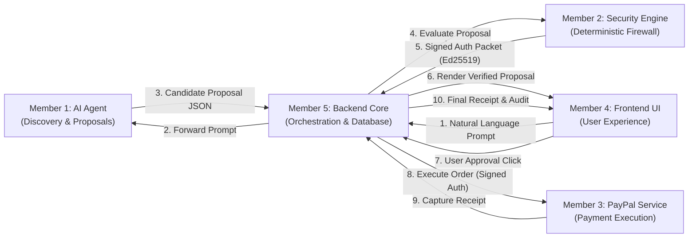

# IntentLock Commerce — Team Structure & Collaboration Protocol

> **Document Status:** CONFIRMED BASELINE  
> **Last Updated:** 2026-11-07  
> **Lead Maintainer:** Aditya Singh (`adityasing9`)  

---

## 1. Team Roster & Module Ownership

| Member | GitHub Username | Role / Module | Dedicated Git Branch | Primary Deliverables |
|---|---|---|---|---|
| **Prince Kumar** | [`DevPrince3`](https://github.com/DevPrince3) | **Member 1: AI Commerce Agent** | `member-1/ai-commerce-agent` | LLM intent extraction, prompt engineering, product discovery adapter (Channel3 — *access unverified; offline fixture of 15–20 products across keyboards, headphones, monitors used until verified*), product matching & ranking algorithms. |
| **diago-1** | [`diago-1`](https://github.com/diago-1) | **Member 2: IntentLock Security Engine** | `member-2/security-engine` | Deterministic policy engine, budget/merchant/spec verifiers, prompt injection detector, recurring fee detector, Ed25519 signing service. |
| **RABINNDRA** | [`EVARA566`](https://github.com/EVARA566) | **Member 3: PayPal Payment Integration** | `member-3/paypal-integration` | PayPal Orders REST API v2 client, PayPal SDK configuration, payment capture handler, webhook signature verifier, idempotency control. |
| **AuGust** | [`AuGust`](https://github.com/AuGust) | **Member 4: Frontend & UI/UX** | `member-4/frontend-ui` | React + Tailwind application, chat-based search interface, product comparison drawer, security firewall inspection panel, PayPal button checkout. *(Note: Collaborator invite status pending verification).* |
| **Aditya Singh** | [`adityasing9`](https://github.com/adityasing9) | **Member 5: Backend & Integration Lead** | `member-5/backend-integration` | Express REST API server, MongoDB architecture, system orchestration, authentication, module integration adapters, audit logging, repository admin. |

---

## 2. Cross-Module Dependency & Handoff Matrix

### Detailed Interfaces

| Integration Pair | Providing Member | Consuming Member | Required Contract / Artifact | Status |
|---|---|---|---|---|
| **Intent Handoff** | Member 5 (Backend) | Member 1 (AI Agent) | User query string, user preference constraints (budget, currency, preferred merchants). | Drafted in `docs/API_CONTRACTS.md` |
| **Proposal Submission** | Member 1 (AI Agent) | Member 5 (Backend) | Structured JSON containing `productId`, `title`, `specs`, `priceMinor`, `merchantId`, `shippingMinor`, `taxMinor`, `isRecurring`. | Drafted in `docs/API_CONTRACTS.md` |
| **Security Evaluation** | Member 5 (Backend) | Member 2 (Security) | Snapshot payload containing raw intent constraints vs. proposal specifications. | Drafted in `docs/API_CONTRACTS.md` |
| **Auth Issuance** | Member 2 (Security) | Member 5 (Backend) | Deterministic outcome (`PASS`/`REVIEW`/`BLOCK`), rule failure details, and Ed25519 signature with single-use nonce. | Drafted in `docs/API_CONTRACTS.md` |
| **Order Dispatch** | Member 5 (Backend) | Member 3 (PayPal) | Verified order details, currency, integer amount, signed authorization receipt, idempotency key. | Drafted in `docs/API_CONTRACTS.md` |
| **Payment Capture** | Member 3 (PayPal) | Member 5 (Backend) | PayPal capture ID, payer details, seller protection status, transaction fee breakdown. | Drafted in `docs/API_CONTRACTS.md` |
| **Frontend Display** | Member 5 (Backend) | Member 4 (Frontend) | REST endpoints for auth, intent submission, proposal inspection, firewall breakdown, and PayPal order callbacks. | Drafted in `docs/API_CONTRACTS.md` |

---

## 3. GitHub Collaboration & Git Workflow

### Branch Isolation Rules
1. Every team member works strictly inside their assigned branch (`member-1/*` through `member-5/*`).
2. **Never commit directly to `main`.** The `main` branch is protected and reserved exclusively for stable, integrated releases.
3. **Never push to another member's branch** without their explicit, documented permission.
4. If a member needs sub-features, they branch off their personal branch:
   `member-5/backend-integration` $\longrightarrow$ `member-5/auth-scaffolding`

### Pull Request & Review Protocol
- When a module feature is complete and verified locally, create a Pull Request targeting `main`.
- **PR Title Convention:** `[Module X] Short description of feature` (e.g., `[Member 5] feat: implement purchase intent endpoints`).
- **PR Requirements for Merge:**
  1. At least 1 approving review from another team member.
  2. All conversation threads resolved.
  3. Stale approvals dismissed upon pushing new commits.
  4. Working tree clean and passing tests.
  5. No merge conflicts with `main`.

### Commit Message Conventions
Follow the Conventional Commits specification:
- `feat:` New functionality (e.g., `feat: add user preference schema`)
- `security:` Security-specific changes (e.g., `security: verify ed25519 signature nonce`)
- `fix:` Bug fixes (e.g., `fix: correct integer minor unit tax rounding`)
- `docs:` Documentation updates (e.g., `docs: update API contracts for security engine`)
- `test:` Unit or integration test suites (e.g., `test: add proposal snapshot validation tests`)
- `refactor:` Code reorganization without behavior change

### Sensitive Credential Protection
- **Zero Credentials in Git:** Never commit `.env`, private keys, PayPal client secrets, or LLM API keys.
- All configuration is distributed via `.env.example` templates with sanitized placeholders.
- A comprehensive `.gitignore` must be present on every branch before installing packages or running builds.

---

## 4. Communication & Contract Revision Protocol

1. **Contract Immutability During Sprints:** Once an interface is defined in `docs/API_CONTRACTS.md`, changing request/response keys requires approval from both the providing and consuming members.
2. **Proposing a Change:**
   - Open a documentation update PR or raise the modification in the team communication channel.
   - Update `docs/API_CONTRACTS.md` with versioning comments (e.g., `v1.1 proposed`).
   - Mock adapters in Member 5's backend will be updated to reflect contract revisions after agreement.
